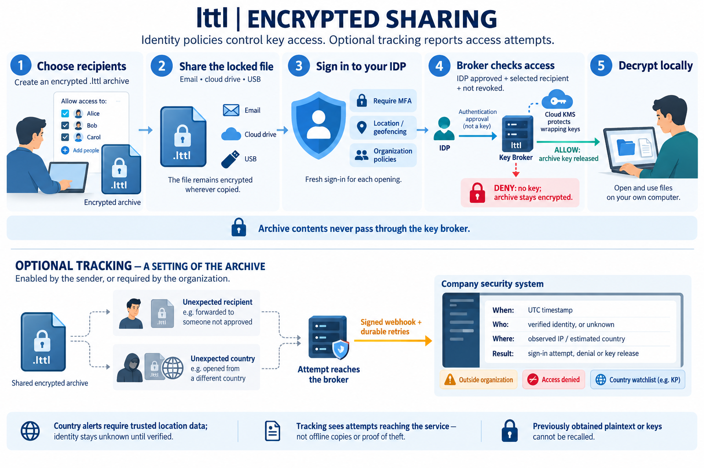

# lttl archive

A Rust archiver for Windows with a desktop interface, CLI, CPU/GPU compression, and identity-protected sharing.

**Alpha software.** Native lttl, ZIP, TAR.ZST and TAR.LZ4 work locally. GPU paths have been tested on Intel Arc and an RTX 4070 Laptop GPU. Identity sharing has local integration coverage; live cloud/IDP deployment is still awaiting pilot validation.

[Download Windows installer](https://github.com/zeniazenin/lttl-archive/releases/tag/v0.1.0-alpha.6) · [Documentation](docs/README.md) · [Build from source](docs/development.md) · [Identity setup](identity-broker/deploy/test-environment.md)

## Our own codec: lttl Fast and lttl Dense

**Faster creation and smaller archives than ZIP and RAR on the numeric datasets tested below.** lttl has its own independently implemented lossless numeric codec: it detects sample layouts, predicts changes between values and packs the residuals. **lttl Fast** favors speed; **lttl Dense** adds Zstandard compression for smaller output. Auto can choose these codecs per block or fall back to standard compression. [How it works](docs/native-compression.md).

These are measurements of the **production alpha.6 archiver**, not the earlier prototype. Cells show **creation time in ms / archive size as a percentage of input**; lower is better for both.

| Input | lttl Dense | ZIP / Deflate 6 | RAR method 5 |
|---|---:|---:|---:|
| Original packed ECG (3.9 MB) | 98.9 / 32.10% | 219.8 / 59.07% | 267.3 / 34.58% |
| Original EDF EEG (10.3 MB) | 113.5 / 38.77% | 747.9 / 55.03% | 502.5 / 44.89% |
| Original terrain (25.9 MB) | 129.7 / 21.87% | 680.4 / 38.88% | 1248.0 / 22.62% |
| Synthetic sensors (16 MiB) | 120.6 / 24.92% | 593.6 / 54.89% | 1420.5 / 35.56% |
| Text control (16 MiB) | 166.8 / 35.75% | 779.6 / 36.95% | 861.0 / 28.91% |

For the original EEG files, Dense created archives **4.4× faster and 13.6% smaller than RAR method 5**, and **6.6× faster and 29.5% smaller than ZIP level 6**. This is workload-specific: RAR compressed the text control more densely. Dense uses its ordinary Zstandard fallback on that text.

Core Ultra 9 185H; CPU only; three serial randomized repetitions per setting; medians include process startup, layout sampling, file IO and an output flush. Eight requested workers (ZIP is serial); RAR uses a 32 MiB dictionary. The full comparison also includes **lttl Fast, ZIP level 1 and RAR method 3**. All **90 creation/extraction pairs** recovered the original SHA-256. OS cache, thermals and background load were uncontrolled, and this is a development corpus—not a guarantee for arbitrary files. [Full results, settings and extraction times](docs/archive-comparison.md) · [Raw measurements](docs/archive-comparison.json) · [Auto benchmarks](docs/native-codec-benchmark.md).

## Features

- Create, list, test and extract native lttl, ZIP, TAR.ZST and TAR.LZ4 archives.
- Modern desktop interface with a simple default view and advanced controls.
- Native lttl Fast/Dense with per-block Auto selection; standard TAR.ZST retains its own Auto policy.
- Multithreaded CPU compression, experimental NVIDIA nvCOMP Zstandard, and portable wgpu LZ4.
- Optional Explorer actions: **Create archive**, **Extract here**, **Extract to named folder**.
- Encrypted `.lttl` envelopes for selected enrolled organization users, with fresh IDP authentication on opening.
- Native Azure Key Vault, AWS KMS and Google Cloud KMS wrapping, plus serverless broker templates.
- Optional per-archive access tracking with signed organization security webhooks, durable retries and country-watchlist alerts. [Setup and limits](docs/archive-tracking.md).
- Signed audit evidence, independent serverless audit vaults, configurable retention and legal holds. [Administrator setup](docs/audit-retention.md).
- **Audit & retention** desktop screen: administrator activity, UTC access deadlines, preservation extensions and legal holds, with reason capture and change review. Included in alpha.6; deploy the matching broker to use it. [Desktop workflow](docs/audit-retention.md#windows-administrator-interface).

lttl includes a documented native container and supports standard archive formats: ZIP/Deflate, TAR + Zstandard, and TAR + LZ4.

## Install on Windows

Download **[lttl alpha.6 for Windows x64](https://github.com/zeniazenin/lttl-archive/releases/download/v0.1.0-alpha.6/lttl-0.1.0-alpha.6-windows-x64-setup.exe)** and its [SHA-256 checksum](https://github.com/zeniazenin/lttl-archive/releases/download/v0.1.0-alpha.6/lttl-0.1.0-alpha.6-windows-x64-setup.exe.sha256).

Setup defaults to `C:\Program Files\lttl`, requests administrator elevation, and supports repair/upgrade of registered machine installations. The Start Menu launches only the app window, with the LTTL logo; `lttl.exe` remains available for CLI use. Native Fast/Dense, Auto, administrator controls, CPU codecs and portable GPU LZ4 are included. Explorer actions and NVIDIA Zstandard runtime components are optional.

Close lttl before upgrading. Uninstall older per-user AppData copies (alpha.4 and earlier) first; alpha.5/alpha.6 machine installations upgrade in place. The installer is **unsigned**. Verify its SHA-256 against the release checksum. See [installation, verification and removal](docs/windows-installer.md).

## Build and run

Install the Windows MSVC Rust toolchain, Visual Studio C++ Build Tools and Windows SDK. Rust **1.92+** builds both the desktop and identity broker. From PowerShell:

```powershell
git clone --branch main https://github.com/zeniazenin/lttl-archive.git
cd lttl-archive
.\scripts\cargo.ps1 build --release --locked
.\target\release\lttl-gui.exe
```

The build does not require downloaded research tools or a GPU. Native NVIDIA Zstandard additionally requires `scripts/setup-gpu.ps1` and `scripts/build-gpu.ps1`; portable wgpu LZ4 does not require CUDA. See [development and packaging](docs/development.md).

## CLI examples

```powershell
# Content-aware compression; output names must be new.
.\target\release\lttl.exe create .\input -o .\backup.lttl --preset balanced
.\target\release\lttl.exe create .\input -o .\backup.zip --format zip --preset fast

# Explicit portable GPU LZ4 (Intel or NVIDIA; requires a compatible driver).
.\target\release\lttl.exe gpu-list
.\target\release\lttl.exe create .\input -o .\backup.tar.lz4 --format tar-lz4 --backend wgpu --adapter nvidia

# Inspect, verify and restore.
.\target\release\lttl.exe list .\backup.tar.zst
.\target\release\lttl.exe test .\backup.tar.zst
.\target\release\lttl.exe extract .\backup.tar.zst -d .\restored
```

Use `lttl --help` and subcommand `--help` for all options. Most results are JSON; progress goes to stderr. The installed executable is normally `C:\Program Files\lttl\lttl.exe` and is not added to PATH.

## Compression choices and measured limits

| Path | Current behavior |
|---|---|
| CPU ZIP | Serial Deflate; Fast can store sampled incompressible files |
| CPU TAR.ZST | Streaming multithreaded Zstandard, preserving cross-file history |
| Auto TAR.ZST | Fast uses CPU without sampling; Balanced/Small use bounded content probes |
| NVIDIA TAR.ZST | Independent nvCOMP chunks; fixed codec setting and transfer/startup costs |
| CPU TAR.LZ4 | Standard LZ4 frames with CPU extraction |
| wgpu TAR.LZ4 | Reused sessions, compacted readback and two pending batches; explicit selection |

In the latest recorded warm-job benchmark, RTX portable LZ4 beat CPU LZ4 on **7/9 datasets**, but GPU archives were larger. Intel had no CPU speed wins. Therefore **Auto TAR.LZ4 still selects CPU**. These measurements include transfer/readback and archive work; they are not universal GPU speedup claims. AMD and Apple silicon hardware are untested. [Full measurements and compression ratios](docs/portable-v3-results.md).

**lttl Fast** and optimized **lttl Dense** are integrated into the native `.lttl` format, Windows interface and Auto selection in alpha.4. [Usage and format](docs/native-compression.md). [Production benchmark](docs/native-codec-benchmark.md). [Preserved algorithm research](research/numeric-v2/README.md).

## Identity-protected sharing



The sender selects enrolled recipients and creates an encrypted `.lttl` archive. A recipient authenticates through the configured IDP, and the broker releases the archive key only if authorized and not revoked. The master wrapping keys stay in the native cloud KMS; archive data keys exist briefly in the broker and desktop. Archive files never pass through the broker.

| Cloud | Broker compute | Wrapping service |
|---|---|---|
| Azure | Functions custom HTTP handler | Key Vault |
| AWS | Lambda with Web Adapter | KMS |
| Google Cloud | Cloud Run serverless container | Cloud KMS |

Shared managed PostgreSQL preserves permissions and one-use authorization state across cold starts. No VM is required, but the database, KMS and networking are separately provisioned services. Entra is the first pilot IDP; guides also cover Okta, Auth0, Keycloak and compatible OIDC/SAML federation.

Start with [the IDP + key-store test guide](identity-broker/deploy/test-environment.md), [sharing workflow](docs/identity-sharing.md), and [deployment overview](identity-broker/deploy/README.md). The installer does not deploy a broker or create cloud resources. Live MFA/location policy, cloud IAM and serverless packages remain pilot acceptance requirements. Access revocation cannot recall plaintext or keys already obtained by an authorized recipient.

## Archive tracking

For an encrypted `.lttl` archive, select **Track access attempts for this archive**, or use:

```powershell
lttl create .\documents -o .\shared.lttl --identity-profile .\company.json --recipient RECIPIENT_BROKER_ID --track-access --alert-country KP
lttl identity events .\shared.lttl --profile .\company.json
```

Tracking is off by default. Organizations can require it for newly created archives. The authenticated archive header and broker record carry the effective policy; recipients cannot disable it with a client setting. Signed webhooks report attempts, verified identity when available, UTC time and network-location evidence. Alerts can flag denied access, users outside configured organization membership, or watched countries.

Upgrade the broker and run `--init-db` before using the new client. Configure the webhook, separate signing/dispatch secrets and a serverless retry schedule. External-user classification requires the organization's broker account list; country alerts require signed estimates from a trusted gateway. Offline copies cannot be detected, and an alert is not proof of theft. [Complete setup, receiver example and limitations](docs/archive-tracking.md).

## Validation and limitations

lttl includes **signed audit export, configurable retention and legal holds**, administered through the identity CLI/API. A separate serverless audit vault supports Azure Blob, S3 and Google Cloud Storage under a security-team identity. Broker auditing is independent of optional location tracking; holds protect broker-managed keys/evidence while allowing access revocation. Archive files themselves must be preserved in retention-controlled storage. Upgrade and configure the broker as well as the desktop; installation does not deploy services. [Configuration, migration, cloud deployment and limitations](docs/audit-retention.md).

Alpha.6 passes desktop and broker regression tests and installed-client integration with a mock IDP and independent mock audit vault. Earlier audit-vault protocol and PostgreSQL/TLS evidence is preserved separately. Tests include signed evidence, replay/tampering, holds, independent access expiry, key destruction, failed export and restart recovery. [Current counts and boundaries](docs/identity-serverless-validation.md) · [Installer results](https://github.com/zeniazenin/lttl-archive/blob/v0.1.0-alpha.6/docs/windows-installer-validation.json).

The earlier portable GPU experiment completed **468 archive/extraction pairs** and **4,316 file-hash checks**. Those GPU measurements were not rerun for alpha.6; the new native numeric codec runs on CPU.

Extraction rejects unsafe paths, links/reparse points, collisions and existing-file overwrites. Checksums detect corruption; identity envelopes add authenticated encryption. Windows ACLs/alternate streams, complete metadata preservation, split volumes, recovery records, archive updates and password-encrypted ZIP are not implemented. Do not use actively changing input as a filesystem-consistent backup. See [the detailed user guide](docs/user-guide.md).

## Repository

| Directory | Contents |
|---|---|
| `src/` | Rust engine, GUI, identity client, WGSL kernels |
| `native/` | Optional NVIDIA bridge and codec experiments |
| `identity-broker/` | Rust identity/key service and cloud deployment templates |
| `installer/windows/` | NSIS Windows installer source |
| `tests/`, `scripts/` | Tests, packaging, benchmarks and research helpers |
| `docs/` | User/developer guides, research and recorded benchmark evidence |

Build outputs, downloaded SDKs/tools, local credentials and benchmark input corpora are excluded. Source and lockfiles are committed; installers are published as GitHub Release assets.

Original lttl code is [MIT licensed](LICENSE). Dependencies, NVIDIA/Microsoft components and historical third-party evidence retain their own terms; see [third-party notices](THIRD_PARTY_NOTICES.md).
