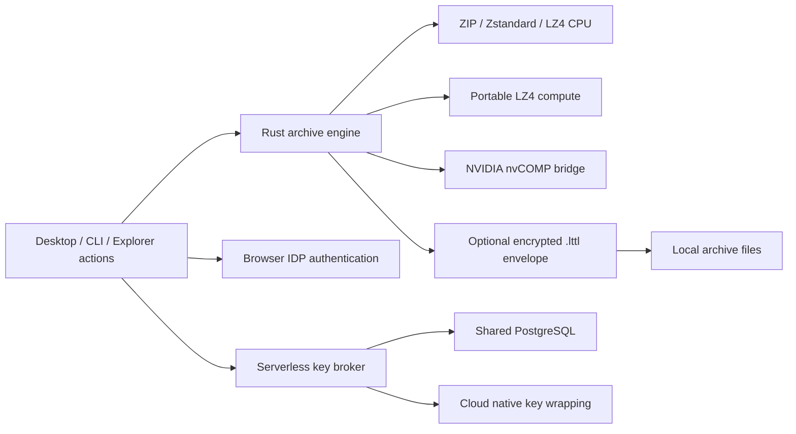

# Architecture

The desktop and CLI call the same Rust library. The broker is a separate administrative deployment and handles identity/key release only.

`src/lib.rs` builds bounded input manifests and performs safe archive publication/extraction. `src/auto.rs` selects Zstandard settings from bounded content probes; Fast skips probes. ZIP has its own CPU Fast sampling policy. `src/portable.rs` manages wgpu adapters, cached sessions, LZ4 batches and compacted readback; WGSL kernels are adjacent. `src/gpu.rs` loads the optional native bridge from `native/gpu_bridge.cpp`. Compression ratio and complete wall time determine useful acceleration; GPU kernel time alone is insufficient.

`src/identity/crypto.rs` implements the authenticated streaming envelope with random data keys, bounded records and an authenticated final record. `src/identity/mod.rs` implements trusted broker profiles, browser/loopback PKCE, enrollment and protected archive operations. Plaintext inner archives use local temporary storage; tokens/keys are not intentionally persisted by the desktop.

`identity-broker/src/main.rs` validates OIDC tokens and recipient grants. `store.rs` persists users, recipient allowlists, wrapped keys, revocations, audit events and short-lived authentication state. Atomic SQL consumes one-use grants across instances. `kms.rs` calls Azure RSA-OAEP-256, AWS symmetric KMS and GCP symmetric KMS; records bind a wrapped key to the archive and configured key reference. Cloud denial has no local-key fallback. Native master keys never enter the desktop or broker.

Azure Functions, AWS Lambda and Google Cloud Run templates terminate external HTTPS and run the same broker. PostgreSQL and KMS are shared services; function-local disk is not durable state. Legacy SQLite/local-master mode remains explicitly separate. Live provider IAM, IDP policy, routing and cold-start/scale behavior still require pilot validation.

Current limitations include enrolled-user rather than directory-wide selection, no bulk KMS rewrap migration, no offline opening, and no recall of plaintext already obtained. See [identity sharing](identity-sharing.md) for the security contract and [validation](identity-serverless-validation.md) for evidence.
