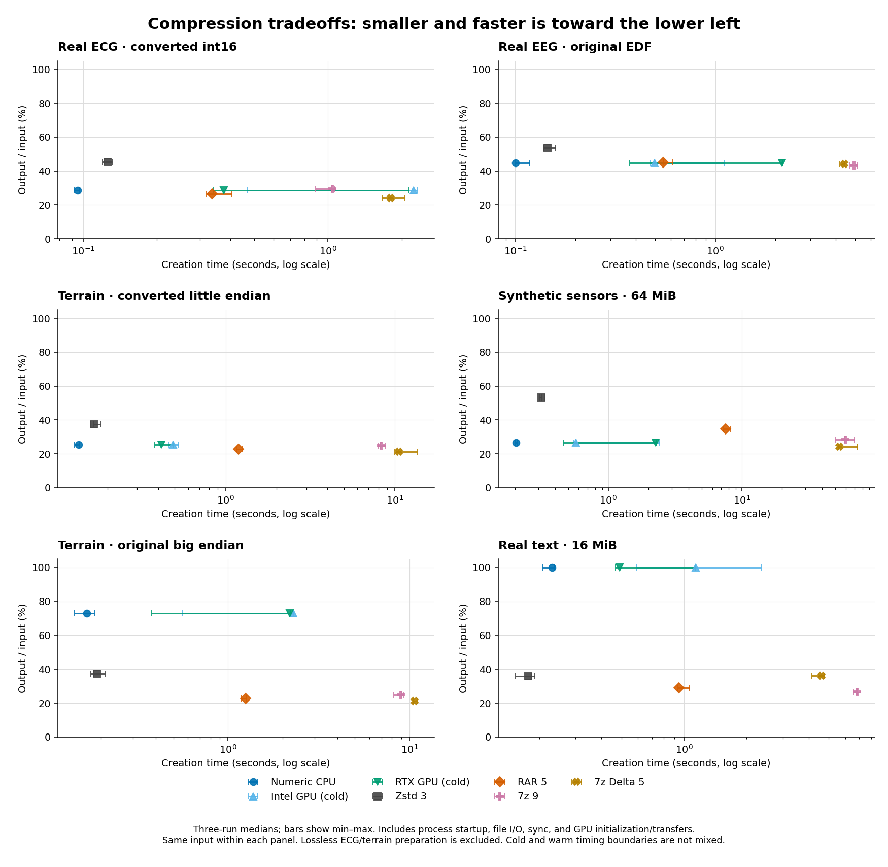

# Codec/application comparison results

Core Ultra 9 185H, Intel Arc integrated graphics, RTX 4070 Laptop GPU. Actual RAR 7.20.3 and official 7-Zip 26.04 x64 standalone console. Zstandard 1.5.7; LZ4 via `lz4_flex` 0.11.6.

**528 fresh-process compression/extraction pairs** and **132 session jobs** passed exact restored-file SHA-256 verification. All numeric archives are byte-identical across CPU and both GPUs, including session runs.

Read [methodology, configurations and reproduction](README.md), [raw measurements](results.json), and [dataset provenance](../numeric-gpu/corpus.json). These are specified settings, not exhaustive tuning or equal-memory comparisons. No production code or Auto policy changed.

## Measured conclusion

The prototype is competitive as a fast numeric specialization, not as a universal replacement for dense archive codecs. The CPU version delivers most of the benefit; this experiment does not establish a large GPU advantage.

* On original EDF EEG, numeric CPU output is 0.7% smaller than RAR method 5 and creation is 5.48x faster. It is 3.0% larger than 7z Ultra and creation is 49.22x faster.
* On converted little-endian terrain, numeric output is 13.1% larger than RAR method 5 and 20.5% larger than delta-filtered 7z, while creation is 8.85x and 78.61x faster respectively. Conversion is excluded from every timing.
* On 64 MiB synthetic sensors, numeric output is 22.9% smaller than RAR method 5 and 5.9% smaller than 7z Ultra, but 10.0% larger than delta-filtered 7z. This is a synthetic specialization result, not a general corpus win.
* Original packed ECG, original big-endian terrain, 12-channel ECG and text expose important weaknesses. Numeric-only stores the text unchanged; the adaptive research fallback reaches 35.75% of input through Zstd 3, versus 28.91% for RAR method 5 and 26.72% for 7z Ultra.
* CPU and GPU compression ratios are identical. In reused sessions, RTX creation takes 81.74 ms versus CPU 89.74 ms on 64 MiB sensors, and 10.84 ms versus 12.66 ms on converted ECG. Intel is usually slower. These modest warm-session differences vary by input, and fresh GPU initialization is expensive. Three repetitions and uncontrolled power/caches do not establish a reliable routing threshold.

The useful next algorithm work is representation-aware transforms (endianness, packed samples and channel strides), a stronger optional entropy stage, and cheap fallback detection. Automatic GPU routing needs larger repeated-job measurements before these small warm gains justify a policy change.

The chart uses fresh-process times only; [vector version](tradeoffs.svg). Detailed tables below include extraction and reused sessions.

## Compressed size

Percent of original input bytes; lower is smaller. Full output including framing/metadata is counted. CPU/GPU numeric outputs have identical size. Converted ECG and terrain representations are separate inputs; conversion is lossless but outside timing. `7z-delta-5` is a manually configured bytewise Delta + LZMA2 competitor, not 7-Zip automatic detection. Its filter distance comes from the prototype’s sample-selected stride.

| Input | Numeric CPU/GPU | Zstd 3 | Zstd 9 | LZ4 | ZIP/Deflate 6 | RAR 3 | RAR 5 | 7z 5 | 7z 9 | 7z Delta 5 |
|---|---:|---:|---:|---:|---:|---:|---:|---:|---:|---:|
| mitbih-original-212 | 100.00% | 58.94% | 52.09% | 91.41% | 56.61% | 34.67% | 34.58% | 42.65% | 42.65% | 72.30% |
| mitbih-s16le | 28.56% | 45.16% | 40.54% | 75.79% | 42.69% | 26.64% | 26.53% | 29.51% | 29.51% | 24.07% |
| eeg-edf-original | 44.59% | 53.66% | 50.87% | 88.99% | 52.93% | 45.24% | 44.89% | 43.30% | 43.28% | 44.19% |
| ptb-12lead-original | 69.31% | 76.53% | 75.80% | 100.00% | 75.02% | 46.58% | 46.10% | 55.65% | 55.65% | 61.68% |
| terrain-hgt-be | 73.05% | 37.33% | 32.31% | 61.85% | 36.88% | 23.03% | 22.62% | 25.20% | 24.89% | 21.22% |
| terrain-s16le | 25.58% | 37.31% | 32.29% | 61.80% | 36.88% | 23.03% | 22.61% | 25.30% | 24.99% | 21.23% |
| raw-sensors-1MiB | 26.66% | 54.11% | 47.29% | 90.82% | 51.52% | 40.29% | 40.21% | 29.94% | 29.94% | 24.81% |
| raw-sensors-16MiB | 26.66% | 53.46% | 43.11% | 90.69% | 51.31% | 35.50% | 35.56% | 28.89% | 28.89% | 24.35% |
| raw-sensors-64MiB | 26.66% | 53.44% | 42.90% | 90.70% | 51.30% | 34.51% | 34.59% | 28.39% | 28.33% | 24.24% |
| independent-noise-16MiB | 100.00% | 100.00% | 100.00% | 100.00% | 100.00% | 100.19% | 100.19% | 100.01% | 100.01% | 100.01% |
| enwik8-16MiB | 100.00% | 35.75% | 31.40% | 57.94% | 35.64% | 29.60% | 28.91% | 26.88% | 26.72% | 36.29% |

## Fresh-process compression time

Milliseconds, medians of three randomized repetitions. Every column includes process startup, input/output, an explicit durability flush, checksums and codec work. GPU columns also include initializing a new device/session plus all transfers and synchronization. These are comparable operation boundaries; they are not kernel-only or reused-session timings.

| Input | Numeric CPU | Intel cold | RTX cold | Zstd 3 | LZ4 | ZIP 6 | RAR 5 | 7z 5 | 7z 9 | 7z Delta 5 |
|---|---:|---:|---:|---:|---:|---:|---:|---:|---:|---:|
| mitbih-original-212 | 98.8 | 1041.9 | 382.4 | 120.4 | 105.5 | 250.7 | 279.9 | 487.0 | 528.6 | 302.3 |
| mitbih-s16le | 94.9 | 2234.9 | 375.4 | 125.8 | 111.1 | 428.3 | 337.2 | 981.6 | 1041.8 | 1805.7 |
| eeg-edf-original | 100.4 | 496.1 | 2156.8 | 145.4 | 130.4 | 751.3 | 550.2 | 4199.3 | 4943.3 | 4431.7 |
| ptb-12lead-original | 83.4 | 499.5 | 944.6 | 94.0 | 85.2 | 70.2 | 127.7 | 123.1 | 105.7 | 105.2 |
| terrain-hgt-be | 166.6 | 2283.4 | 2188.7 | 189.2 | 177.0 | 1730.4 | 1245.5 | 8201.2 | 8984.2 | 10680.6 |
| terrain-s16le | 134.9 | 488.8 | 417.1 | 166.4 | 167.5 | 1768.2 | 1193.8 | 8771.5 | 8309.0 | 10605.6 |
| raw-sensors-1MiB | 83.3 | 2216.4 | 355.4 | 96.0 | 83.6 | 97.5 | 134.2 | 134.1 | 139.7 | 226.1 |
| raw-sensors-16MiB | 126.4 | 485.7 | 1001.9 | 188.4 | 158.5 | 994.8 | 1328.6 | 8709.8 | 8661.6 | 10335.8 |
| raw-sensors-64MiB | 203.4 | 573.2 | 2259.4 | 314.4 | 373.2 | 4194.7 | 7549.5 | 58032.1 | 59698.4 | 53827.1 |
| independent-noise-16MiB | 139.9 | 1142.8 | 981.6 | 148.7 | 133.0 | 366.8 | 677.1 | 719.5 | 804.3 | 818.6 |
| enwik8-16MiB | 230.4 | 1138.0 | 489.0 | 176.7 | 173.9 | 1698.2 | 945.7 | 7399.3 | 6831.6 | 4619.7 |

## Fresh-process extraction time

Milliseconds, medians of three runs, including process startup, reading the archive, decoding, writing and syncing the restored stream. GPU-created numeric archives use the same CPU decoder and identical bytes as the CPU numeric column. No GPU decoding is claimed.

| Input | Numeric CPU | Zstd 3 | LZ4 | ZIP 6 | RAR 5 | 7z 5 | 7z 9 | 7z Delta 5 |
|---|---:|---:|---:|---:|---:|---:|---:|---:|
| mitbih-original-212 | 102.6 | 101.5 | 97.3 | 60.7 | 109.2 | 89.1 | 90.0 | 129.7 |
| mitbih-s16le | 96.2 | 108.1 | 101.4 | 70.4 | 125.4 | 92.4 | 106.8 | 66.2 |
| eeg-edf-original | 111.0 | 125.3 | 120.8 | 95.5 | 158.6 | 159.1 | 170.3 | 170.9 |
| ptb-12lead-original | 87.6 | 91.5 | 85.3 | 36.8 | 98.2 | 43.6 | 44.0 | 46.1 |
| terrain-hgt-be | 155.5 | 175.9 | 151.0 | 164.2 | 199.3 | 262.0 | 292.7 | 232.4 |
| terrain-s16le | 126.2 | 158.9 | 157.1 | 167.2 | 197.3 | 277.0 | 277.8 | 232.5 |
| raw-sensors-1MiB | 91.6 | 93.4 | 93.0 | 36.2 | 97.5 | 44.8 | 42.7 | 38.5 |
| raw-sensors-16MiB | 124.6 | 151.7 | 141.1 | 159.4 | 175.8 | 256.6 | 260.8 | 155.1 |
| raw-sensors-64MiB | 196.3 | 343.7 | 267.3 | 517.1 | 443.0 | 1022.3 | 999.7 | 599.9 |
| independent-noise-16MiB | 122.7 | 127.3 | 130.1 | 50.3 | 144.2 | 55.7 | 60.4 | 79.5 |
| enwik8-16MiB | 256.9 | 256.8 | 264.3 | 327.9 | 346.5 | 317.2 | 328.5 | 391.5 |

## Reused sessions: a separate timing boundary

Milliseconds, medians of three warm jobs after one initial job in an already-running process. Includes reads/writes, sync, selection, framing/checksums, GPU staging/transfers and synchronization, but excludes process/session initialization. These values must not be directly substituted into the RAR/7-Zip fresh-process comparison above. All outputs match the fresh-process numeric archives exactly.

| Input | CPU warm create | Intel warm create | RTX warm create | CPU warm recovery | Intel init | RTX init |
|---|---:|---:|---:|---:|---:|---:|
| mitbih-original-212 | 15.25 | 15.38 | 14.85 | 16.87 | 310.42 | 233.65 |
| mitbih-s16le | 12.66 | 11.96 | 10.84 | 19.12 | 310.90 | 220.91 |
| eeg-edf-original | 20.70 | 27.00 | 19.85 | 26.00 | 349.31 | 205.29 |
| ptb-12lead-original | 6.91 | 8.22 | 6.29 | 13.05 | 370.49 | 234.25 |
| terrain-hgt-be | 55.12 | 62.48 | 53.96 | 54.16 | 349.12 | 221.87 |
| terrain-s16le | 35.16 | 43.43 | 34.77 | 89.77 | 366.72 | 243.45 |
| raw-sensors-1MiB | 7.99 | 8.02 | 7.85 | 10.14 | 308.84 | 305.10 |
| raw-sensors-16MiB | 24.02 | 32.53 | 22.51 | 42.53 | 324.64 | 223.91 |
| raw-sensors-64MiB | 89.74 | 97.70 | 81.74 | 121.27 | 311.22 | 210.88 |
| independent-noise-16MiB | 45.13 | 47.14 | 42.51 | 35.33 | 338.24 | 228.83 |
| enwik8-16MiB | 47.98 | 46.15 | 43.70 | 150.79 | 330.86 | 249.86 |

## Numeric tradeoffs against dense encoders

Positive size delta means numeric output is larger; negative means smaller. Speed factors use fresh-process creation medians (competitor / numeric), not mixed cold/warm timings. These are per-input tradeoffs, not a universal ranking.

| Input | Numeric vs RAR 5 bytes | Numeric vs 7z 9 bytes | Numeric vs Delta 5 bytes | Speed vs RAR 5 | Speed vs 7z 9 | Speed vs Delta 5 |
|---|---:|---:|---:|---:|---:|---:|
| mitbih-original-212 | +189.2% | +134.4% | +38.3% | 2.83x | 5.35x | 3.06x |
| mitbih-s16le | +7.6% | -3.2% | +18.7% | 3.55x | 10.98x | 19.02x |
| eeg-edf-original | -0.7% | +3.0% | +0.9% | 5.48x | 49.22x | 44.12x |
| ptb-12lead-original | +50.4% | +24.5% | +12.4% | 1.53x | 1.27x | 1.26x |
| terrain-hgt-be | +223.0% | +193.5% | +244.3% | 7.48x | 53.93x | 64.11x |
| terrain-s16le | +13.1% | +2.4% | +20.5% | 8.85x | 61.59x | 78.61x |
| raw-sensors-1MiB | -33.7% | -11.0% | +7.5% | 1.61x | 1.68x | 2.71x |
| raw-sensors-16MiB | -25.0% | -7.7% | +9.5% | 10.51x | 68.52x | 81.77x |
| raw-sensors-64MiB | -22.9% | -5.9% | +10.0% | 37.11x | 293.43x | 264.57x |
| independent-noise-16MiB | -0.2% | -0.0% | -0.0% | 4.84x | 5.75x | 5.85x |
| enwik8-16MiB | +245.9% | +274.2% | +175.6% | 4.10x | 29.64x | 20.05x |

## All configurations and variability

All times in milliseconds. Caches, temperature, power and background activity are uncontrolled. Min/max ranges expose variability; three repetitions do not establish statistical significance. Dictionary settings differ, and peak memory was not measured.

### mitbih-original-212

Input: 3,900,000 bytes. Original packed ECG records 100 and 101 concatenated in order, no sample conversion.

| Configuration | Output bytes | Output/input | Create median | Create range | Extract median | Extract range |
|---|---:|---:|---:|---:|---:|---:|
| cpu-numeric | 3,900,026 | 100.00% | 98.8 | 96.7–101.3 | 102.6 | 90.9–103.9 |
| intel | 3,900,026 | 100.00% | 1041.9 | 433.8–2305.4 | 94.4 | 91.0–100.7 |
| nvidia | 3,900,026 | 100.00% | 382.4 | 326.6–2132.0 | 91.3 | 85.8–104.0 |
| adaptive | 2,298,763 | 58.94% | 118.1 | 116.9–120.4 | 98.2 | 92.0–100.2 |
| zstd-1 | 2,653,712 | 68.04% | 103.2 | 99.5–109.5 | 95.9 | 95.9–97.9 |
| zstd-3 | 2,298,763 | 58.94% | 120.4 | 115.0–122.7 | 101.5 | 94.6–109.1 |
| zstd-9 | 2,031,615 | 52.09% | 191.7 | 181.9–207.5 | 107.1 | 98.5–107.7 |
| lz4 | 3,565,173 | 91.41% | 105.5 | 93.8–110.0 | 97.3 | 91.8–98.5 |
| store | 3,900,026 | 100.00% | 87.0 | 86.2–97.4 | 87.0 | 83.9–92.4 |
| zip-deflate-6 | 2,207,763 | 56.61% | 250.7 | 233.0–274.0 | 60.7 | 59.2–62.8 |
| rar-3 | 1,352,219 | 34.67% | 229.2 | 222.7–231.0 | 108.5 | 103.7–110.5 |
| rar-5 | 1,348,552 | 34.58% | 279.9 | 261.1–287.3 | 109.2 | 107.7–109.4 |
| 7z-1 | 1,913,379 | 49.06% | 508.5 | 501.9–655.8 | 86.1 | 82.4–91.2 |
| 7z-5 | 1,663,520 | 42.65% | 487.0 | 484.8–597.8 | 89.1 | 86.9–92.5 |
| 7z-9 | 1,663,520 | 42.65% | 528.6 | 464.3–633.9 | 90.0 | 86.4–101.7 |
| 7z-delta-5 | 2,819,602 | 72.30% | 302.3 | 282.4–314.7 | 129.7 | 116.2–148.9 |

### mitbih-s16le

Input: 5,200,000 bytes. Same records unpacked losslessly from WFDB 212 to interleaved signed 16-bit little-endian samples. Exact 212 repacking verified. Conversion is outside compression timing.

| Configuration | Output bytes | Output/input | Create median | Create range | Extract median | Extract range |
|---|---:|---:|---:|---:|---:|---:|
| cpu-numeric | 1,485,120 | 28.56% | 94.9 | 92.6–96.5 | 96.2 | 93.7–96.5 |
| intel | 1,485,120 | 28.56% | 2234.9 | 469.9–2310.3 | 103.8 | 94.3–108.6 |
| nvidia | 1,485,120 | 28.56% | 375.4 | 339.4–2145.1 | 94.3 | 93.7–98.6 |
| adaptive | 1,485,120 | 28.56% | 91.7 | 88.1–101.9 | 90.5 | 86.7–101.2 |
| zstd-1 | 2,621,384 | 50.41% | 105.7 | 103.6–119.4 | 96.4 | 95.9–108.4 |
| zstd-3 | 2,348,117 | 45.16% | 125.8 | 120.1–131.6 | 108.1 | 97.2–109.5 |
| zstd-9 | 2,108,006 | 40.54% | 234.0 | 219.8–244.2 | 108.6 | 103.3–108.7 |
| lz4 | 3,941,074 | 75.79% | 111.1 | 106.4–119.7 | 101.4 | 92.1–106.2 |
| store | 5,200,026 | 100.00% | 93.3 | 89.2–99.3 | 95.3 | 93.5–96.4 |
| zip-deflate-6 | 2,219,703 | 42.69% | 428.3 | 413.7–469.0 | 70.4 | 61.2–73.2 |
| rar-3 | 1,385,079 | 26.64% | 244.7 | 238.4–260.4 | 107.1 | 105.6–114.7 |
| rar-5 | 1,379,625 | 26.53% | 337.2 | 319.5–404.8 | 125.4 | 110.2–134.0 |
| 7z-1 | 1,831,508 | 35.22% | 611.1 | 492.5–840.7 | 91.8 | 80.9–102.2 |
| 7z-5 | 1,534,511 | 29.51% | 981.6 | 852.3–1038.5 | 92.4 | 92.1–97.4 |
| 7z-9 | 1,534,511 | 29.51% | 1041.8 | 888.2–1062.4 | 106.8 | 104.8–112.3 |
| 7z-delta-5 | 1,251,442 | 24.07% | 1805.7 | 1659.9–2051.7 | 66.2 | 63.1–69.6 |

### eeg-edf-original

Input: 10,305,024 bytes. Four complete original EDF+ files S001R03 through S004R03 concatenated in order, including headers and annotation channels. No conversion, scaling, duplication or quantization.

| Configuration | Output bytes | Output/input | Create median | Create range | Extract median | Extract range |
|---|---:|---:|---:|---:|---:|---:|
| cpu-numeric | 4,594,850 | 44.59% | 100.4 | 100.0–118.1 | 111.0 | 109.2–111.7 |
| intel | 4,594,850 | 44.59% | 496.1 | 471.3–1105.3 | 117.1 | 103.1–123.7 |
| nvidia | 4,594,850 | 44.59% | 2156.8 | 374.4–2172.4 | 106.7 | 106.1–120.8 |
| adaptive | 5,529,877 | 53.66% | 151.8 | 144.5–157.7 | 125.4 | 124.0–129.4 |
| zstd-1 | 6,388,928 | 62.00% | 110.7 | 107.6–118.8 | 111.6 | 110.5–134.1 |
| zstd-3 | 5,529,877 | 53.66% | 145.4 | 139.0–159.1 | 125.3 | 117.1–132.0 |
| zstd-9 | 5,242,502 | 50.87% | 366.0 | 335.2–388.7 | 125.1 | 115.9–130.0 |
| lz4 | 9,170,428 | 88.99% | 130.4 | 122.5–130.9 | 120.8 | 115.9–121.6 |
| store | 10,305,050 | 100.00% | 114.3 | 102.6–116.3 | 110.2 | 109.6–110.6 |
| zip-deflate-6 | 5,454,163 | 52.93% | 751.3 | 720.7–756.8 | 95.5 | 94.7–110.3 |
| rar-3 | 4,661,520 | 45.24% | 365.3 | 352.6–376.8 | 154.9 | 148.9–167.9 |
| rar-5 | 4,626,120 | 44.89% | 550.2 | 548.1–615.7 | 158.6 | 157.4–160.1 |
| 7z-1 | 4,823,881 | 46.81% | 2596.4 | 2130.7–2870.7 | 154.3 | 148.6–162.1 |
| 7z-5 | 4,461,770 | 43.30% | 4199.3 | 3967.1–4546.1 | 159.1 | 156.7–162.1 |
| 7z-9 | 4,460,439 | 43.28% | 4943.3 | 4730.8–5151.9 | 170.3 | 158.8–173.5 |
| 7z-delta-5 | 4,553,724 | 44.19% | 4431.7 | 4189.7–4447.7 | 170.9 | 166.1–188.1 |

### ptb-12lead-original

Input: 921,600 bytes. Original 12-channel signed 16-bit little-endian ECG .dat file; 12-channel stride is deliberately outside the original codec candidate set. No conversion.

| Configuration | Output bytes | Output/input | Create median | Create range | Extract median | Extract range |
|---|---:|---:|---:|---:|---:|---:|
| cpu-numeric | 638,790 | 69.31% | 83.4 | 82.8–86.9 | 87.6 | 81.6–89.3 |
| intel | 638,790 | 69.31% | 499.5 | 485.8–2276.0 | 86.4 | 86.4–87.2 |
| nvidia | 638,790 | 69.31% | 944.6 | 376.3–2133.3 | 86.3 | 83.3–89.3 |
| adaptive | 705,310 | 76.53% | 101.9 | 101.5–115.1 | 95.8 | 87.1–97.0 |
| zstd-1 | 708,393 | 76.87% | 94.9 | 82.7–101.5 | 95.9 | 90.7–100.6 |
| zstd-3 | 705,310 | 76.53% | 94.0 | 91.1–102.6 | 91.5 | 82.0–92.9 |
| zstd-9 | 698,618 | 75.80% | 105.6 | 100.9–107.1 | 86.6 | 83.3–95.9 |
| lz4 | 921,627 | 100.00% | 85.2 | 82.6–92.0 | 85.3 | 82.1–96.4 |
| store | 921,626 | 100.00% | 82.2 | 79.4–101.9 | 92.7 | 91.4–95.6 |
| zip-deflate-6 | 691,376 | 75.02% | 70.2 | 62.5–73.3 | 36.8 | 34.4–37.3 |
| rar-3 | 429,277 | 46.58% | 111.3 | 99.3–127.3 | 93.0 | 81.1–110.8 |
| rar-5 | 424,817 | 46.10% | 127.7 | 109.9–133.8 | 98.2 | 96.1–106.2 |
| 7z-1 | 627,943 | 68.14% | 101.5 | 80.8–106.0 | 48.6 | 44.0–50.2 |
| 7z-5 | 512,894 | 55.65% | 123.1 | 105.3–126.0 | 43.6 | 43.3–54.8 |
| 7z-9 | 512,894 | 55.65% | 105.7 | 104.2–108.9 | 44.0 | 42.8–49.8 |
| 7z-delta-5 | 568,430 | 61.68% | 105.2 | 97.5–106.9 | 46.1 | 46.0–50.3 |

### terrain-hgt-be

Input: 25,934,402 bytes. Complete N37W122 elevation tile, gzip transport removed. Original big-endian signed 16-bit HGT samples.

| Configuration | Output bytes | Output/input | Create median | Create range | Extract median | Extract range |
|---|---:|---:|---:|---:|---:|---:|
| cpu-numeric | 18,945,820 | 73.05% | 166.6 | 143.1–183.5 | 155.5 | 141.3–161.8 |
| intel | 18,945,820 | 73.05% | 2283.4 | 558.5–2293.8 | 149.7 | 143.6–151.8 |
| nvidia | 18,945,820 | 73.05% | 2188.7 | 378.7–2216.4 | 146.2 | 137.7–149.6 |
| adaptive | 9,682,603 | 37.33% | 159.8 | 157.5–197.2 | 161.9 | 158.2–177.6 |
| zstd-1 | 11,617,581 | 44.80% | 152.3 | 143.5–153.8 | 158.1 | 152.7–162.5 |
| zstd-3 | 9,682,603 | 37.33% | 189.2 | 175.2–209.4 | 175.9 | 171.6–177.2 |
| zstd-9 | 8,379,404 | 32.31% | 462.1 | 406.7–470.9 | 160.1 | 159.1–164.4 |
| lz4 | 16,039,474 | 61.85% | 177.0 | 168.0–179.8 | 151.0 | 142.9–162.3 |
| store | 25,934,428 | 100.00% | 146.5 | 136.7–150.2 | 130.9 | 128.4–142.5 |
| zip-deflate-6 | 9,563,450 | 36.88% | 1730.4 | 1661.6–1756.8 | 164.2 | 160.7–164.3 |
| rar-3 | 5,973,974 | 23.03% | 724.7 | 702.4–767.8 | 200.0 | 189.4–201.9 |
| rar-5 | 5,865,183 | 22.62% | 1245.5 | 1179.7–1264.9 | 199.3 | 191.3–209.8 |
| 7z-1 | 7,408,784 | 28.57% | 2089.9 | 1912.7–2124.9 | 173.8 | 158.6–180.9 |
| 7z-5 | 6,534,747 | 25.20% | 8201.2 | 7221.5–8684.7 | 262.0 | 256.5–265.2 |
| 7z-9 | 6,454,649 | 24.89% | 8984.2 | 8184.1–9280.0 | 292.7 | 267.8–331.2 |
| 7z-delta-5 | 5,503,160 | 21.22% | 10680.6 | 10427.9–11001.8 | 232.4 | 219.6–233.7 |

### terrain-s16le

Input: 25,934,402 bytes. Same complete elevation tile with reversible byte swap to little endian, no quantization. Byte-swap conversion is outside compression timing.

| Configuration | Output bytes | Output/input | Create median | Create range | Extract median | Extract range |
|---|---:|---:|---:|---:|---:|---:|
| cpu-numeric | 6,634,304 | 25.58% | 134.9 | 128.3–137.2 | 126.2 | 120.7–139.7 |
| intel | 6,634,304 | 25.58% | 488.8 | 463.0–527.1 | 131.8 | 128.9–133.2 |
| nvidia | 6,634,304 | 25.58% | 417.1 | 381.5–487.0 | 139.1 | 135.2–155.3 |
| adaptive | 6,634,304 | 25.58% | 125.6 | 123.0–141.6 | 131.3 | 128.2–148.7 |
| zstd-1 | 11,614,053 | 44.78% | 148.4 | 141.2–150.9 | 156.4 | 155.8–158.9 |
| zstd-3 | 9,674,854 | 37.31% | 166.4 | 164.8–182.3 | 158.9 | 158.8–168.9 |
| zstd-9 | 8,374,936 | 32.29% | 468.3 | 466.0–479.0 | 167.7 | 160.8–171.0 |
| lz4 | 16,026,239 | 61.80% | 167.5 | 167.3–176.4 | 157.1 | 151.9–158.9 |
| store | 25,934,428 | 100.00% | 141.9 | 130.8–147.7 | 143.1 | 135.1–148.7 |
| zip-deflate-6 | 9,563,515 | 36.88% | 1768.2 | 1713.3–1873.3 | 167.2 | 162.1–176.0 |
| rar-3 | 5,972,382 | 23.03% | 782.3 | 762.7–789.8 | 213.1 | 190.0–219.7 |
| rar-5 | 5,864,026 | 22.61% | 1193.8 | 1168.5–1252.3 | 197.3 | 183.3–207.3 |
| 7z-1 | 7,411,068 | 28.58% | 1916.2 | 1786.4–1966.0 | 163.3 | 159.1–163.7 |
| 7z-5 | 6,561,058 | 25.30% | 8771.5 | 8393.1–9166.0 | 277.0 | 267.8–307.6 |
| 7z-9 | 6,480,395 | 24.99% | 8309.0 | 7996.5–8864.8 | 277.8 | 272.5–322.8 |
| 7z-delta-5 | 5,505,391 | 21.23% | 10605.6 | 9989.1–13556.7 | 232.5 | 224.4–275.6 |

### raw-sensors-1MiB

Input: 1,048,576 bytes. Existing corpus control: first 1 MiB. Sensor/noise controls are synthetic; enwik8 is real text.

| Configuration | Output bytes | Output/input | Create median | Create range | Extract median | Extract range |
|---|---:|---:|---:|---:|---:|---:|
| cpu-numeric | 279,574 | 26.66% | 83.3 | 81.2–94.7 | 91.6 | 84.5–98.2 |
| intel | 279,574 | 26.66% | 2216.4 | 435.5–2270.8 | 88.9 | 87.4–92.1 |
| nvidia | 279,574 | 26.66% | 355.4 | 315.0–360.3 | 94.4 | 91.9–94.6 |
| adaptive | 279,574 | 26.66% | 87.2 | 80.3–91.5 | 80.8 | 79.2–109.7 |
| zstd-1 | 749,422 | 71.47% | 96.3 | 95.3–99.3 | 92.4 | 82.0–93.5 |
| zstd-3 | 567,391 | 54.11% | 96.0 | 91.7–97.0 | 93.4 | 84.1–97.3 |
| zstd-9 | 495,906 | 47.29% | 113.6 | 113.5–144.0 | 95.2 | 79.7–95.9 |
| lz4 | 952,306 | 90.82% | 83.6 | 82.7–88.0 | 93.0 | 81.7–97.5 |
| store | 1,048,602 | 100.00% | 82.9 | 82.0–85.0 | 80.5 | 79.2–81.4 |
| zip-deflate-6 | 540,218 | 51.52% | 97.5 | 86.5–100.4 | 36.2 | 32.9–36.5 |
| rar-3 | 422,470 | 40.29% | 126.6 | 113.3–133.8 | 107.4 | 100.4–111.6 |
| rar-5 | 421,581 | 40.21% | 134.2 | 131.6–145.0 | 97.5 | 90.0–99.4 |
| 7z-1 | 412,190 | 39.31% | 88.4 | 86.2–121.3 | 37.6 | 36.6–45.2 |
| 7z-5 | 313,957 | 29.94% | 134.1 | 130.0–141.5 | 44.8 | 42.0–50.0 |
| 7z-9 | 313,957 | 29.94% | 139.7 | 139.6–144.6 | 42.7 | 42.2–44.6 |
| 7z-delta-5 | 260,117 | 24.81% | 226.1 | 192.7–229.2 | 38.5 | 36.9–39.6 |

### raw-sensors-16MiB

Input: 16,777,216 bytes. Existing corpus control: first 16 MiB. Sensor/noise controls are synthetic; enwik8 is real text.

| Configuration | Output bytes | Output/input | Create median | Create range | Extract median | Extract range |
|---|---:|---:|---:|---:|---:|---:|
| cpu-numeric | 4,472,942 | 26.66% | 126.4 | 112.4–127.2 | 124.6 | 109.8–125.1 |
| intel | 4,472,942 | 26.66% | 485.7 | 472.3–529.7 | 122.1 | 111.3–124.4 |
| nvidia | 4,472,942 | 26.66% | 1001.9 | 372.9–2158.0 | 113.5 | 112.4–122.5 |
| adaptive | 4,472,942 | 26.66% | 114.4 | 109.5–120.3 | 118.5 | 105.8–119.7 |
| zstd-1 | 11,978,953 | 71.40% | 138.6 | 128.2–157.0 | 143.0 | 141.6–144.3 |
| zstd-3 | 8,969,590 | 53.46% | 188.4 | 181.5–199.9 | 151.7 | 151.4–152.0 |
| zstd-9 | 7,232,384 | 43.11% | 644.5 | 533.5–646.6 | 146.5 | 140.9–153.2 |
| lz4 | 15,215,227 | 90.69% | 158.5 | 155.1–173.7 | 141.1 | 140.4–142.8 |
| store | 16,777,242 | 100.00% | 122.2 | 117.1–127.6 | 120.0 | 115.3–136.9 |
| zip-deflate-6 | 8,608,972 | 51.31% | 994.8 | 944.5–1053.6 | 159.4 | 152.4–174.5 |
| rar-3 | 5,955,859 | 35.50% | 982.5 | 970.9–1080.6 | 189.0 | 188.9–197.0 |
| rar-5 | 5,965,736 | 35.56% | 1328.6 | 1292.3–1344.9 | 175.8 | 173.9–194.7 |
| 7z-1 | 6,352,806 | 37.87% | 4211.0 | 4113.4–5479.0 | 206.0 | 191.4–208.9 |
| 7z-5 | 4,846,365 | 28.89% | 8709.8 | 7183.0–8787.3 | 256.6 | 240.4–305.7 |
| 7z-9 | 4,846,365 | 28.89% | 8661.6 | 8187.3–9802.3 | 260.8 | 257.3–269.3 |
| 7z-delta-5 | 4,084,732 | 24.35% | 10335.8 | 9478.2–13660.7 | 155.1 | 152.9–182.8 |

### raw-sensors-64MiB

Input: 67,108,864 bytes. Existing corpus control: first 64 MiB. Sensor/noise controls are synthetic; enwik8 is real text.

| Configuration | Output bytes | Output/input | Create median | Create range | Extract median | Extract range |
|---|---:|---:|---:|---:|---:|---:|
| cpu-numeric | 17,891,694 | 26.66% | 203.4 | 201.2–207.1 | 196.3 | 193.6–207.7 |
| intel | 17,891,694 | 26.66% | 573.2 | 549.1–2425.5 | 203.8 | 195.4–219.9 |
| nvidia | 17,891,694 | 26.66% | 2259.4 | 461.3–2296.5 | 201.9 | 200.9–205.6 |
| adaptive | 17,891,694 | 26.66% | 201.7 | 198.5–211.4 | 205.3 | 202.6–208.4 |
| zstd-1 | 47,913,075 | 71.40% | 254.1 | 252.7–264.5 | 291.7 | 287.4–296.9 |
| zstd-3 | 35,861,700 | 53.44% | 314.4 | 304.7–318.3 | 343.7 | 342.2–346.6 |
| zstd-9 | 28,788,681 | 42.90% | 1140.8 | 1111.9–1267.4 | 332.8 | 300.8–340.3 |
| lz4 | 60,866,467 | 90.70% | 373.2 | 366.4–382.2 | 267.3 | 266.8–273.5 |
| store | 67,108,890 | 100.00% | 241.7 | 227.3–243.0 | 220.8 | 219.6–225.7 |
| zip-deflate-6 | 34,427,413 | 51.30% | 4194.7 | 4132.0–4253.1 | 517.1 | 506.8–540.9 |
| rar-3 | 23,157,169 | 34.51% | 6413.7 | 5661.8–6466.9 | 450.2 | 411.5–470.5 |
| rar-5 | 23,213,950 | 34.59% | 7549.5 | 7280.4–8174.4 | 443.0 | 440.0–471.1 |
| 7z-1 | 25,408,179 | 37.86% | 7621.5 | 6927.2–8030.6 | 295.2 | 286.6–399.9 |
| 7z-5 | 19,053,724 | 28.39% | 58032.1 | 57792.6–67242.0 | 1022.3 | 990.3–1127.5 |
| 7z-9 | 19,015,273 | 28.33% | 59698.4 | 50241.8–69833.1 | 999.7 | 971.1–1001.4 |
| 7z-delta-5 | 16,266,835 | 24.24% | 53827.1 | 52577.4–73624.9 | 599.9 | 566.3–632.4 |

### independent-noise-16MiB

Input: 16,777,216 bytes. Existing corpus control: first 16 MiB. Sensor/noise controls are synthetic; enwik8 is real text.

| Configuration | Output bytes | Output/input | Create median | Create range | Extract median | Extract range |
|---|---:|---:|---:|---:|---:|---:|
| cpu-numeric | 16,777,242 | 100.00% | 139.9 | 134.9–141.8 | 122.7 | 120.5–125.2 |
| intel | 16,777,242 | 100.00% | 1142.8 | 488.5–2307.1 | 117.6 | 116.5–120.4 |
| nvidia | 16,777,242 | 100.00% | 981.6 | 402.0–2499.1 | 123.3 | 123.0–124.3 |
| adaptive | 16,777,242 | 100.00% | 144.1 | 140.1–147.4 | 125.4 | 121.9–131.7 |
| zstd-1 | 16,777,242 | 100.00% | 154.8 | 149.7–156.0 | 117.9 | 117.6–123.3 |
| zstd-3 | 16,777,242 | 100.00% | 148.7 | 139.6–152.1 | 127.3 | 111.8–130.2 |
| zstd-9 | 16,777,242 | 100.00% | 155.2 | 148.8–170.2 | 124.1 | 113.8–125.5 |
| lz4 | 16,777,255 | 100.00% | 133.0 | 123.8–137.6 | 130.1 | 130.1–133.3 |
| store | 16,777,242 | 100.00% | 119.8 | 118.9–145.2 | 118.3 | 117.8–123.5 |
| zip-deflate-6 | 16,777,404 | 100.00% | 366.8 | 341.9–381.3 | 50.3 | 46.9–53.2 |
| rar-3 | 16,808,685 | 100.19% | 557.1 | 530.9–566.3 | 142.9 | 137.6–143.2 |
| rar-5 | 16,808,685 | 100.19% | 677.1 | 594.4–741.5 | 144.2 | 143.3–153.6 |
| 7z-1 | 16,778,420 | 100.01% | 6726.0 | 5662.6–7910.3 | 55.2 | 52.7–58.4 |
| 7z-5 | 16,778,420 | 100.01% | 719.5 | 716.9–806.8 | 55.7 | 52.9–60.4 |
| 7z-9 | 16,778,420 | 100.01% | 804.3 | 793.6–831.5 | 60.4 | 52.8–67.1 |
| 7z-delta-5 | 16,778,436 | 100.01% | 818.6 | 690.7–835.8 | 79.5 | 69.5–79.6 |

### enwik8-16MiB

Input: 16,777,216 bytes. Existing corpus control: first 16 MiB. Sensor/noise controls are synthetic; enwik8 is real text.

| Configuration | Output bytes | Output/input | Create median | Create range | Extract median | Extract range |
|---|---:|---:|---:|---:|---:|---:|
| cpu-numeric | 16,777,242 | 100.00% | 230.4 | 207.8–236.0 | 256.9 | 225.3–286.1 |
| intel | 16,777,242 | 100.00% | 1138.0 | 588.7–2353.8 | 221.8 | 214.9–232.5 |
| nvidia | 16,777,242 | 100.00% | 489.0 | 468.1–1133.4 | 286.7 | 233.4–315.6 |
| adaptive | 5,998,117 | 35.75% | 146.7 | 142.7–158.2 | 248.6 | 210.5–259.3 |
| zstd-1 | 6,902,113 | 41.14% | 135.0 | 131.4–136.4 | 266.8 | 252.7–273.6 |
| zstd-3 | 5,998,117 | 35.75% | 176.7 | 153.4–190.4 | 256.8 | 245.4–276.3 |
| zstd-9 | 5,267,970 | 31.40% | 523.1 | 413.8–527.9 | 265.4 | 256.7–267.7 |
| lz4 | 9,720,214 | 57.94% | 173.9 | 163.2–178.3 | 264.3 | 258.3–264.7 |
| store | 16,777,242 | 100.00% | 192.1 | 191.5–192.3 | 232.5 | 216.3–249.8 |
| zip-deflate-6 | 5,978,711 | 35.64% | 1698.2 | 1625.6–1785.4 | 327.9 | 294.0–338.4 |
| rar-3 | 4,965,448 | 29.60% | 720.1 | 713.7–721.2 | 309.8 | 280.0–352.9 |
| rar-5 | 4,850,108 | 28.91% | 945.7 | 934.7–1066.4 | 346.5 | 335.0–361.5 |
| 7z-1 | 5,278,399 | 31.46% | 1953.7 | 1887.4–2003.2 | 344.5 | 331.9–361.3 |
| 7z-5 | 4,509,537 | 26.88% | 7399.3 | 6612.3–7998.7 | 317.2 | 274.7–321.3 |
| 7z-9 | 4,483,036 | 26.72% | 6831.6 | 6590.5–6884.9 | 328.5 | 321.0–374.4 |
| 7z-delta-5 | 6,087,673 | 36.29% | 4619.7 | 4132.7–4766.9 | 391.5 | 348.1–404.2 |

## Interpretation limits

* A specialized numeric encoder is not a general archiver replacement. Text, original packed ECG and big-endian samples can favor established encoders strongly. The adaptive research fallback is a separate row.
* Delta + LZMA2 demonstrates that relevant numeric transforms already exist in a standard tool. A win against generic settings alone is insufficient evidence of a new compression-density breakthrough.
* The 7z normal/ultra and RAR settings are fully specified and decoded by their real tools. This run does not substitute Python/liblzma for the 7-Zip application.
* No mixing of numerical warm timings and application cold timings is used to calculate the speed factors. GPU session reuse may help interactive use, but standard tools would also benefit from avoiding startup.
* This corpus emphasizes numeric workloads. It lacks broad source trees, executables, office documents, images/video and multi-file solid grouping. These results are not a general market-wide ranking.
