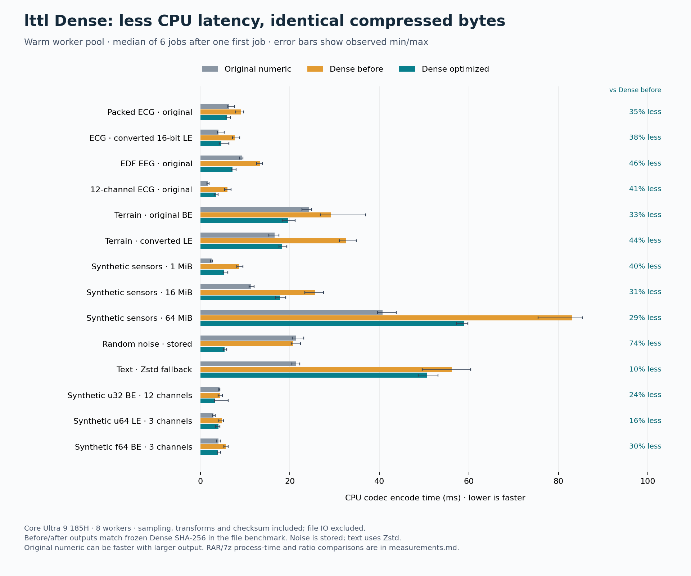

# lttl Dense optimization results

**Compression is unchanged:** every before/after file is byte-identical to the frozen previous Dense output (SHA-256 checked). All 294 file creation/extraction pairs and 294 in-memory round trips passed recovery checks. The release example passed 16 tests.

Intel Core Ultra 9 185H; eight requested CPU workers. Actual RAR 7.20.3 and 7-Zip 26.04. All Rust controls share one executable. This is a CPU research prototype, not a production or GPU rollout. [Methodology](README.md), [file measurements](results.json), [memory measurements](memory.json).

## Outcome

* **Original packed ECG:** warm codec time 9.12 → 5.95 ms (34.8% lower). Original numeric: 6.37 ms. Output remains 32.10% of input, versus 100.00% original, 34.58% RAR, 42.65% 7z Ultra and 34.35% filtered 7z.
* **Original EDF EEG:** warm codec time 13.28 → 7.20 ms (45.8% lower). Original numeric: 9.33 ms. Output remains 38.77% of input, versus 44.59% original, 44.89% RAR, 43.28% 7z Ultra and 44.19% filtered 7z.
* **Original 12-channel ECG:** warm codec time 6.03 → 3.57 ms (40.8% lower). Original numeric: 1.73 ms. Output remains 40.51% of input, versus 69.31% original, 46.10% RAR, 55.65% 7z Ultra and 41.74% filtered 7z.
* **Original big-endian terrain:** warm codec time 29.12 → 19.60 ms (32.7% lower). Original numeric: 24.30 ms. Output remains 21.87% of input, versus 73.05% original, 22.62% RAR, 24.89% 7z Ultra and 21.22% filtered 7z.
* **64 MiB synthetic sensors:** warm codec time 83.01 → 59.00 ms (28.9% lower). Original numeric: 40.72 ms. Output remains 24.92% of input, versus 26.66% original, 34.59% RAR, 28.33% 7z Ultra and 24.24% filtered 7z.

On the 64 MiB sensor file, complete creation takes 186.4 ms for optimized Dense, 8171.5 ms for RAR, 66734.1 ms for 7z Ultra and 79723.8 ms for filtered 7z. The filtered 7z output remains slightly smaller. These compare complete process times at the recorded settings.

The optimization removes a substantial part of Dense overhead, but it does not eliminate the cost of entropy compression. Several inputs still encode more slowly than the original numeric codec. Stored noise benefits from avoiding redundant copies; that is not a compression improvement. Text selects ordinary Zstd, while the forced original numeric codec stores it, so their speed comparison must be read alongside size. File-to-file savings are smaller and less consistent than codec savings: startup and IO can dominate, and some small-file process medians barely improve or regress despite lower codec time.

## Codec time: fresh process and warm worker pool

Milliseconds; lower is faster. Fresh values are medians of three independent process jobs, excluding IO and pool startup. Warm values are medians of six consecutive jobs after one first job, also excluding IO. Both include selection and checksum. Reduction compares optimized Dense to frozen Dense, not to original numeric. These are elapsed times, not total CPU usage.

| Input | Fresh original | Fresh before | Fresh optimized | Reduction | Warm original | Warm before | Warm optimized | Reduction |
|---|---:|---:|---:|---:|---:|---:|---:|---:|
| mitbih-original-212 | 6.37 | 10.51 | 8.11 | 22.8% | 6.37 | 9.12 | 5.95 | 34.8% |
| mitbih-s16le | 5.06 | 9.57 | 5.43 | 43.3% | 4.04 | 7.62 | 4.69 | 38.5% |
| eeg-edf-original | 9.60 | 15.94 | 7.62 | 52.2% | 9.33 | 13.28 | 7.20 | 45.8% |
| ptb-12lead-original | 2.29 | 7.34 | 4.12 | 43.9% | 1.73 | 6.03 | 3.57 | 40.8% |
| terrain-hgt-be | 23.90 | 32.12 | 21.00 | 34.6% | 24.30 | 29.12 | 19.60 | 32.7% |
| terrain-s16le | 16.12 | 33.02 | 19.93 | 39.7% | 16.61 | 32.54 | 18.24 | 43.9% |
| raw-sensors-1MiB | 2.57 | 9.47 | 6.91 | 27.0% | 2.52 | 8.62 | 5.21 | 39.5% |
| raw-sensors-16MiB | 12.28 | 26.50 | 20.81 | 21.5% | 11.35 | 25.60 | 17.78 | 30.6% |
| raw-sensors-64MiB | 44.69 | 93.95 | 68.16 | 27.5% | 40.72 | 83.01 | 59.00 | 28.9% |
| independent-noise-16MiB | 21.57 | 22.37 | 6.23 | 72.1% | 21.42 | 20.76 | 5.41 | 73.9% |
| enwik8-16MiB | 21.65 | 63.46 | 55.77 | 12.1% | 21.33 | 56.16 | 50.64 | 9.8% |
| synthetic-u32be-12ch | 4.09 | 5.83 | 4.36 | 25.3% | 4.24 | 4.39 | 3.34 | 23.8% |
| synthetic-u64le-3ch | 3.32 | 5.64 | 4.58 | 18.7% | 2.91 | 4.81 | 4.02 | 16.4% |
| synthetic-f64be-3ch | 4.78 | 7.12 | 4.87 | 31.6% | 4.03 | 5.68 | 4.00 | 29.7% |

[Vector chart](codec-time.svg). Error bars are observed minimum and maximum, not confidence intervals.

## Compression ratio

Output bytes / input bytes, percent. Headers included; lower is smaller. Frozen and optimized Dense have exactly the same bytes, not just rounded ratios.

| Input | Original numeric | Dense before | Dense optimized | Zstd 3 | RAR 5 | 7z Ultra | 7z Delta 5 |
|---|---:|---:|---:|---:|---:|---:|---:|
| mitbih-original-212 | 100.00% | 32.10% | 32.10% | 58.94% | 34.58% | 42.65% | 34.35% |
| mitbih-s16le | 28.56% | 24.07% | 24.07% | 45.16% | 26.53% | 29.51% | 24.07% |
| eeg-edf-original | 44.59% | 38.77% | 38.77% | 53.66% | 44.89% | 43.28% | 44.19% |
| ptb-12lead-original | 69.31% | 40.51% | 40.51% | 76.53% | 46.10% | 55.65% | 41.74% |
| terrain-hgt-be | 73.05% | 21.87% | 21.87% | 37.33% | 22.62% | 24.89% | 21.22% |
| terrain-s16le | 25.58% | 21.87% | 21.87% | 37.31% | 22.61% | 24.99% | 21.23% |
| raw-sensors-1MiB | 26.66% | 24.93% | 24.93% | 54.11% | 40.21% | 29.94% | 24.81% |
| raw-sensors-16MiB | 26.66% | 24.92% | 24.92% | 53.46% | 35.56% | 28.89% | 24.35% |
| raw-sensors-64MiB | 26.66% | 24.92% | 24.92% | 53.44% | 34.59% | 28.33% | 24.24% |
| independent-noise-16MiB | 100.00% | 100.00% | 100.00% | 100.00% | 100.19% | 100.01% | 100.01% |
| enwik8-16MiB | 100.00% | 35.75% | 35.75% | 35.75% | 28.91% | 26.72% | 36.29% |
| synthetic-u32be-12ch | 100.00% | 8.92% | 8.92% | 79.91% | 10.44% | 13.27% | 9.98% |
| synthetic-u64le-3ch | 70.32% | 4.93% | 4.93% | 18.39% | 4.83% | 7.58% | 5.28% |
| synthetic-f64be-3ch | 100.00% | 6.80% | 6.80% | 34.73% | 5.37% | 9.08% | 24.32% |

## Creation: complete process time

Milliseconds, medians of three runs. Common boundary: process launch through exit plus output fsync. Includes IO. RAR/7z and Rust are compared only at this common boundary. Decoder logic was not optimized.

| Input | Original numeric | Dense before | Dense optimized | Zstd 3 | RAR 5 | 7z Ultra | 7z Delta 5 |
|---|---:|---:|---:|---:|---:|---:|---:|
| mitbih-original-212 | 40.1 | 41.6 | 41.4 | 57.6 | 293.8 | 537.8 | 1285.0 |
| mitbih-s16le | 40.5 | 46.1 | 37.0 | 71.5 | 333.1 | 1004.5 | 2183.2 |
| eeg-edf-original | 50.7 | 55.2 | 49.2 | 117.2 | 583.4 | 4420.8 | 5063.2 |
| ptb-12lead-original | 34.5 | 38.1 | 32.4 | 35.7 | 127.5 | 114.9 | 112.1 |
| terrain-hgt-be | 86.0 | 83.0 | 74.5 | 126.5 | 1239.5 | 8176.7 | 14614.4 |
| terrain-s16le | 72.2 | 82.4 | 69.9 | 135.9 | 1284.6 | 10192.7 | 14732.2 |
| raw-sensors-1MiB | 35.9 | 39.5 | 33.9 | 37.8 | 143.0 | 136.6 | 200.0 |
| raw-sensors-16MiB | 63.0 | 76.4 | 74.0 | 119.9 | 1346.4 | 9755.6 | 12797.8 |
| raw-sensors-64MiB | 153.2 | 202.5 | 186.4 | 247.0 | 8171.5 | 66734.1 | 79723.8 |
| independent-noise-16MiB | 82.3 | 79.9 | 66.5 | 88.2 | 640.4 | 841.1 | 743.0 |
| enwik8-16MiB | 216.9 | 118.7 | 100.1 | 101.5 | 1026.5 | 9133.7 | 5463.2 |
| synthetic-u32be-12ch | 37.4 | 36.7 | 36.7 | 54.8 | 193.0 | 119.8 | 570.3 |
| synthetic-u64le-3ch | 33.6 | 34.6 | 36.5 | 47.5 | 172.6 | 238.9 | 280.3 |
| synthetic-f64be-3ch | 35.6 | 40.1 | 34.5 | 43.0 | 168.6 | 172.3 | 158.5 |

## Extraction: complete process time

Milliseconds, medians of three runs. Common boundary: process launch through exit plus output fsync. Includes IO. RAR/7z and Rust are compared only at this common boundary. Decoder logic was not optimized.

| Input | Original numeric | Dense before | Dense optimized | Zstd 3 | RAR 5 | 7z Ultra | 7z Delta 5 |
|---|---:|---:|---:|---:|---:|---:|---:|
| mitbih-original-212 | 34.5 | 36.9 | 40.7 | 39.5 | 114.8 | 104.1 | 64.7 |
| mitbih-s16le | 38.3 | 43.9 | 41.9 | 51.0 | 122.8 | 104.4 | 75.9 |
| eeg-edf-original | 51.4 | 61.5 | 56.5 | 73.2 | 161.8 | 161.9 | 174.9 |
| ptb-12lead-original | 32.1 | 30.2 | 31.4 | 33.8 | 101.8 | 50.0 | 41.9 |
| terrain-hgt-be | 82.0 | 92.5 | 92.1 | 115.3 | 207.5 | 260.1 | 241.8 |
| terrain-s16le | 73.3 | 94.0 | 95.9 | 126.1 | 212.5 | 264.4 | 238.0 |
| raw-sensors-1MiB | 32.7 | 31.4 | 34.7 | 30.8 | 100.7 | 41.6 | 40.4 |
| raw-sensors-16MiB | 58.3 | 76.9 | 75.7 | 97.9 | 189.6 | 277.0 | 158.5 |
| raw-sensors-64MiB | 144.3 | 180.6 | 210.0 | 284.1 | 468.9 | 1020.4 | 613.7 |
| independent-noise-16MiB | 62.7 | 64.3 | 65.1 | 67.6 | 154.1 | 67.3 | 75.2 |
| enwik8-16MiB | 256.7 | 281.7 | 266.1 | 278.5 | 363.0 | 359.3 | 384.3 |
| synthetic-u32be-12ch | 29.5 | 32.8 | 33.3 | 38.4 | 104.5 | 54.6 | 47.6 |
| synthetic-u64le-3ch | 35.8 | 32.2 | 32.0 | 40.7 | 103.6 | 45.0 | 34.9 |
| synthetic-f64be-3ch | 31.0 | 34.9 | 30.3 | 34.4 | 113.8 | 48.7 | 63.4 |

## Warm phase observations

Medians in milliseconds. Selection includes the parallel candidate trials. Chunk wall time includes transform and entropy work. Worker sums overlap and are **not** additive to wall time or measurements of CPU utilization. Framing includes checksum and output assembly. Zero detailed phases mean the stored/plain-Zstd fallback is uninstrumented.

| Input | Before selection | Optimized selection | Chunk wall | Transform worker sum | Entropy worker sum | Framing |
|---|---:|---:|---:|---:|---:|---:|
| mitbih-original-212 | 3.39 | 1.27 | 3.98 | 11.89 | 2.28 | 0.68 |
| mitbih-s16le | 2.81 | 1.17 | 2.62 | 9.40 | 2.46 | 0.79 |
| eeg-edf-original | 2.68 | 1.26 | 3.86 | 5.36 | 18.80 | 2.10 |
| ptb-12lead-original | 2.42 | 1.14 | 2.12 | 0.28 | 1.79 | 0.18 |
| terrain-hgt-be | 2.50 | 1.78 | 13.38 | 10.49 | 77.41 | 3.56 |
| terrain-s16le | 2.82 | 1.44 | 12.96 | 11.65 | 77.37 | 3.53 |
| raw-sensors-1MiB | 2.72 | 1.11 | 3.91 | 0.23 | 3.64 | 0.19 |
| raw-sensors-16MiB | 2.81 | 1.56 | 13.52 | 7.16 | 74.58 | 2.52 |
| raw-sensors-64MiB | 2.52 | 1.24 | 47.11 | 25.39 | 322.25 | 10.23 |
| independent-noise-16MiB | 2.49 | 1.16 | 0.00 | 0.00 | 0.00 | 0.00 |
| enwik8-16MiB | 3.26 | 1.97 | 0.00 | 0.00 | 0.00 | 0.00 |
| synthetic-u32be-12ch | 1.78 | 0.87 | 2.04 | 3.04 | 0.83 | 0.17 |
| synthetic-u64le-3ch | 2.07 | 1.07 | 2.70 | 2.72 | 2.28 | 0.19 |
| synthetic-f64be-3ch | 2.28 | 1.00 | 2.71 | 2.54 | 2.66 | 0.25 |

## Warm-job variability and first-job cost

First job is reported separately; it is not a guaranteed cold hardware/OS cache measurement. Warm ranges cover jobs 1–6. All values are codec milliseconds.

| Input / method | First encode | Warm encode median | Warm encode range | Warm decode median | Warm decode range |
|---|---:|---:|---:|---:|---:|
| mitbih-original-212 / original | 6.63 | 6.37 | 6.10–7.69 | 1.10 | 1.01–1.16 |
| mitbih-original-212 / before | 10.30 | 9.12 | 7.91–9.65 | 7.40 | 7.30–8.25 |
| mitbih-original-212 / after | 7.19 | 5.95 | 5.70–6.70 | 7.67 | 7.06–8.92 |
| mitbih-s16le / original | 4.61 | 4.04 | 3.76–5.34 | 3.77 | 3.53–4.56 |
| mitbih-s16le / before | 10.66 | 7.62 | 7.15–8.76 | 8.78 | 7.46–9.71 |
| mitbih-s16le / after | 5.71 | 4.69 | 4.20–6.39 | 7.47 | 7.08–8.46 |
| eeg-edf-original / original | 8.62 | 9.33 | 8.77–9.54 | 7.38 | 7.18–8.65 |
| eeg-edf-original / before | 15.13 | 13.28 | 12.57–13.82 | 16.39 | 15.37–17.56 |
| eeg-edf-original / after | 7.63 | 7.20 | 7.01–7.98 | 17.32 | 17.09–18.75 |
| ptb-12lead-original / original | 2.14 | 1.73 | 1.50–1.98 | 1.48 | 1.44–1.59 |
| ptb-12lead-original / before | 7.59 | 6.03 | 5.40–6.83 | 4.19 | 3.74–4.71 |
| ptb-12lead-original / after | 4.29 | 3.57 | 3.08–3.98 | 4.08 | 3.92–4.68 |
| terrain-hgt-be / original | 23.91 | 24.30 | 22.73–24.83 | 16.95 | 16.42–17.72 |
| terrain-hgt-be / before | 30.48 | 29.12 | 26.78–36.94 | 35.85 | 35.48–37.62 |
| terrain-hgt-be / after | 19.54 | 19.60 | 18.24–21.13 | 37.76 | 36.76–38.75 |
| terrain-s16le / original | 17.58 | 16.61 | 15.28–17.53 | 17.06 | 15.96–18.60 |
| terrain-s16le / before | 31.33 | 32.54 | 31.02–34.87 | 37.81 | 36.76–41.17 |
| terrain-s16le / after | 18.79 | 18.24 | 17.55–19.33 | 35.68 | 34.68–36.36 |
| raw-sensors-1MiB / original | 2.44 | 2.52 | 2.25–2.67 | 1.73 | 1.67–1.86 |
| raw-sensors-1MiB / before | 9.15 | 8.62 | 8.15–9.54 | 4.87 | 4.58–6.05 |
| raw-sensors-1MiB / after | 6.36 | 5.21 | 5.05–6.17 | 4.56 | 4.30–4.71 |
| raw-sensors-16MiB / original | 11.95 | 11.35 | 10.90–11.97 | 11.31 | 10.29–12.49 |
| raw-sensors-16MiB / before | 26.27 | 25.60 | 23.33–27.55 | 22.62 | 21.83–25.28 |
| raw-sensors-16MiB / after | 19.03 | 17.78 | 16.84–19.05 | 21.52 | 21.26–22.80 |
| raw-sensors-64MiB / original | 40.16 | 40.72 | 39.56–43.79 | 39.13 | 38.35–41.45 |
| raw-sensors-64MiB / before | 88.77 | 83.01 | 75.44–85.35 | 84.20 | 80.86–85.74 |
| raw-sensors-64MiB / after | 54.14 | 59.00 | 57.21–59.80 | 85.86 | 80.08–89.40 |
| independent-noise-16MiB / original | 22.24 | 21.42 | 20.49–23.12 | 4.44 | 4.09–4.60 |
| independent-noise-16MiB / before | 23.24 | 20.76 | 20.29–22.36 | 4.49 | 4.43–4.96 |
| independent-noise-16MiB / after | 5.94 | 5.41 | 5.13–5.89 | 4.32 | 3.98–4.55 |
| enwik8-16MiB / original | 22.66 | 21.33 | 20.46–22.18 | 4.27 | 3.92–4.72 |
| enwik8-16MiB / before | 49.11 | 56.16 | 49.59–60.45 | 32.65 | 30.93–36.26 |
| enwik8-16MiB / after | 55.14 | 50.64 | 48.66–53.13 | 31.75 | 29.67–33.11 |
| synthetic-u32be-12ch / original | 4.20 | 4.24 | 4.13–4.33 | 0.55 | 0.52–0.82 |
| synthetic-u32be-12ch / before | 5.50 | 4.39 | 3.94–4.95 | 2.89 | 2.80–3.38 |
| synthetic-u32be-12ch / after | 4.39 | 3.34 | 3.17–6.21 | 2.89 | 2.79–3.42 |
| synthetic-u64le-3ch / original | 3.61 | 2.91 | 2.72–3.34 | 2.28 | 2.09–2.35 |
| synthetic-u64le-3ch / before | 5.81 | 4.81 | 4.14–5.13 | 3.47 | 3.22–4.04 |
| synthetic-u64le-3ch / after | 4.22 | 4.02 | 3.41–4.33 | 3.49 | 3.15–3.89 |
| synthetic-f64be-3ch / original | 4.61 | 4.03 | 3.67–4.43 | 0.50 | 0.49–0.53 |
| synthetic-f64be-3ch / before | 6.73 | 5.68 | 5.24–6.19 | 3.75 | 3.48–4.28 |
| synthetic-f64be-3ch / after | 4.96 | 4.00 | 3.89–4.49 | 3.74 | 3.47–3.91 |

## Every file configuration and observed variability

### mitbih-original-212

3,900,000 input bytes. Original packed ECG records 100 and 101 concatenated in order, no sample conversion.

| Method | Output bytes | Create median | Create range | Extract median | Extract range |
|---|---:|---:|---:|---:|---:|
| original | 3,900,026 | 40.1 | 38.4–45.9 | 34.5 | 31.6–36.3 |
| before | 1,251,822 | 41.6 | 37.7–42.1 | 36.9 | 33.4–42.9 |
| after | 1,251,822 | 41.4 | 33.3–50.7 | 40.7 | 33.6–52.7 |
| zstd-3 | 2,298,763 | 57.6 | 56.0–57.9 | 39.5 | 35.3–40.9 |
| rar-5 | 1,348,552 | 293.8 | 281.9–296.8 | 114.8 | 113.6–117.3 |
| 7z-9 | 1,663,520 | 537.8 | 510.4–841.6 | 104.1 | 96.3–114.8 |
| 7z-delta-5 | 1,339,675 | 1285.0 | 1223.2–1681.5 | 64.7 | 63.5–81.9 |

### mitbih-s16le

5,200,000 input bytes. Same records unpacked losslessly from WFDB 212 to interleaved signed 16-bit little-endian samples. Exact 212 repacking verified. Conversion is outside compression timing.

| Method | Output bytes | Create median | Create range | Extract median | Extract range |
|---|---:|---:|---:|---:|---:|
| original | 1,485,120 | 40.5 | 37.0–45.6 | 38.3 | 36.5–41.4 |
| before | 1,251,787 | 46.1 | 44.4–46.3 | 43.9 | 43.2–44.8 |
| after | 1,251,787 | 37.0 | 33.0–40.9 | 41.9 | 38.2–46.1 |
| zstd-3 | 2,348,117 | 71.5 | 68.0–93.3 | 51.0 | 47.4–54.8 |
| rar-5 | 1,379,625 | 333.1 | 332.2–364.0 | 122.8 | 122.3–126.3 |
| 7z-9 | 1,534,511 | 1004.5 | 960.4–1071.4 | 104.4 | 98.9–107.5 |
| 7z-delta-5 | 1,251,442 | 2183.2 | 2160.8–2426.6 | 75.9 | 71.8–82.4 |

### eeg-edf-original

10,305,024 input bytes. Four complete original EDF+ files S001R03 through S004R03 concatenated in order, including headers and annotation channels. No conversion, scaling, duplication or quantization.

| Method | Output bytes | Create median | Create range | Extract median | Extract range |
|---|---:|---:|---:|---:|---:|
| original | 4,594,850 | 50.7 | 50.4–51.6 | 51.4 | 49.9–52.0 |
| before | 3,995,180 | 55.2 | 50.4–64.6 | 61.5 | 56.1–62.0 |
| after | 3,995,180 | 49.2 | 47.9–51.4 | 56.5 | 54.5–59.2 |
| zstd-3 | 5,529,877 | 117.2 | 98.8–121.7 | 73.2 | 65.2–78.5 |
| rar-5 | 4,626,120 | 583.4 | 558.4–585.9 | 161.8 | 159.8–161.8 |
| 7z-9 | 4,460,439 | 4420.8 | 3930.4–4685.0 | 161.9 | 155.3–167.8 |
| 7z-delta-5 | 4,553,724 | 5063.2 | 4332.0–5109.6 | 174.9 | 169.2–177.6 |

### ptb-12lead-original

921,600 input bytes. Original 12-channel signed 16-bit little-endian ECG .dat file; 12-channel stride is deliberately outside the original codec candidate set. No conversion.

| Method | Output bytes | Create median | Create range | Extract median | Extract range |
|---|---:|---:|---:|---:|---:|
| original | 638,790 | 34.5 | 26.7–35.3 | 32.1 | 24.5–34.6 |
| before | 373,342 | 38.1 | 38.0–38.7 | 30.2 | 29.0–32.0 |
| after | 373,342 | 32.4 | 30.5–33.1 | 31.4 | 27.5–31.6 |
| zstd-3 | 705,310 | 35.7 | 35.3–39.2 | 33.8 | 31.9–34.0 |
| rar-5 | 424,817 | 127.5 | 121.0–131.9 | 101.8 | 92.4–109.0 |
| 7z-9 | 512,894 | 114.9 | 109.6–117.9 | 50.0 | 49.6–55.2 |
| 7z-delta-5 | 384,683 | 112.1 | 111.7–112.3 | 41.9 | 39.7–43.2 |

### terrain-hgt-be

25,934,402 input bytes. Complete N37W122 elevation tile, gzip transport removed. Original big-endian signed 16-bit HGT samples.

| Method | Output bytes | Create median | Create range | Extract median | Extract range |
|---|---:|---:|---:|---:|---:|
| original | 18,945,820 | 86.0 | 84.8–89.4 | 82.0 | 78.9–101.7 |
| before | 5,672,840 | 83.0 | 82.7–83.4 | 92.5 | 91.4–92.9 |
| after | 5,672,840 | 74.5 | 65.0–74.5 | 92.1 | 91.9–96.0 |
| zstd-3 | 9,682,603 | 126.5 | 111.6–145.6 | 115.3 | 106.1–123.7 |
| rar-5 | 5,865,183 | 1239.5 | 1168.7–1303.2 | 207.5 | 189.9–252.3 |
| 7z-9 | 6,454,649 | 8176.7 | 7709.2–10862.5 | 260.1 | 254.1–262.9 |
| 7z-delta-5 | 5,503,160 | 14614.4 | 14013.2–16094.0 | 241.8 | 231.7–246.1 |

### terrain-s16le

25,934,402 input bytes. Same complete elevation tile with reversible byte swap to little endian, no quantization. Byte-swap conversion is outside compression timing.

| Method | Output bytes | Create median | Create range | Extract median | Extract range |
|---|---:|---:|---:|---:|---:|
| original | 6,634,304 | 72.2 | 65.9–73.0 | 73.3 | 72.8–90.1 |
| before | 5,672,840 | 82.4 | 81.6–88.3 | 94.0 | 89.1–94.6 |
| after | 5,672,840 | 69.9 | 66.9–72.3 | 95.9 | 91.6–96.8 |
| zstd-3 | 9,674,854 | 135.9 | 111.1–144.3 | 126.1 | 106.3–127.1 |
| rar-5 | 5,864,026 | 1284.6 | 1207.1–1335.1 | 212.5 | 187.5–219.4 |
| 7z-9 | 6,480,395 | 10192.7 | 7935.8–12312.6 | 264.4 | 256.2–349.6 |
| 7z-delta-5 | 5,505,391 | 14732.2 | 13914.3–15104.6 | 238.0 | 228.9–295.1 |

### raw-sensors-1MiB

1,048,576 input bytes. Existing corpus control: first 1 MiB. Sensor/noise controls are synthetic; enwik8 is real text.

| Method | Output bytes | Create median | Create range | Extract median | Extract range |
|---|---:|---:|---:|---:|---:|
| original | 279,574 | 35.9 | 32.6–36.5 | 32.7 | 30.7–44.4 |
| before | 261,427 | 39.5 | 32.0–41.4 | 31.4 | 29.2–33.6 |
| after | 261,427 | 33.9 | 33.8–40.2 | 34.7 | 34.3–35.2 |
| zstd-3 | 567,391 | 37.8 | 35.2–40.3 | 30.8 | 30.4–32.6 |
| rar-5 | 421,581 | 143.0 | 141.0–152.3 | 100.7 | 100.2–102.4 |
| 7z-9 | 313,957 | 136.6 | 133.1–184.8 | 41.6 | 40.8–51.4 |
| 7z-delta-5 | 260,117 | 200.0 | 196.7–275.9 | 40.4 | 37.9–43.8 |

### raw-sensors-16MiB

16,777,216 input bytes. Existing corpus control: first 16 MiB. Sensor/noise controls are synthetic; enwik8 is real text.

| Method | Output bytes | Create median | Create range | Extract median | Extract range |
|---|---:|---:|---:|---:|---:|
| original | 4,472,942 | 63.0 | 52.7–63.1 | 58.3 | 49.9–61.6 |
| before | 4,181,435 | 76.4 | 75.4–82.7 | 76.9 | 67.7–80.7 |
| after | 4,181,435 | 74.0 | 72.8–85.0 | 75.7 | 74.1–77.4 |
| zstd-3 | 8,969,590 | 119.9 | 111.4–135.6 | 97.9 | 92.0–101.6 |
| rar-5 | 5,965,736 | 1346.4 | 1281.7–1365.3 | 189.6 | 176.8–197.8 |
| 7z-9 | 4,846,365 | 9755.6 | 9675.6–10343.1 | 277.0 | 273.8–340.0 |
| 7z-delta-5 | 4,084,732 | 12797.8 | 12641.5–12874.9 | 158.5 | 148.1–161.1 |

### raw-sensors-64MiB

67,108,864 input bytes. Existing corpus control: first 64 MiB. Sensor/noise controls are synthetic; enwik8 is real text.

| Method | Output bytes | Create median | Create range | Extract median | Extract range |
|---|---:|---:|---:|---:|---:|
| original | 17,891,694 | 153.2 | 147.9–154.6 | 144.3 | 137.1–159.7 |
| before | 16,725,440 | 202.5 | 181.6–205.1 | 180.6 | 179.1–190.8 |
| after | 16,725,440 | 186.4 | 167.5–192.8 | 210.0 | 207.7–280.8 |
| zstd-3 | 35,861,700 | 247.0 | 231.5–263.6 | 284.1 | 271.1–301.6 |
| rar-5 | 23,213,950 | 8171.5 | 7079.2–8587.3 | 468.9 | 428.2–492.5 |
| 7z-9 | 19,015,273 | 66734.1 | 56202.8–68545.4 | 1020.4 | 1014.3–1038.4 |
| 7z-delta-5 | 16,266,835 | 79723.8 | 76266.7–81093.5 | 613.7 | 568.7–648.9 |

### independent-noise-16MiB

16,777,216 input bytes. Existing corpus control: first 16 MiB. Sensor/noise controls are synthetic; enwik8 is real text.

| Method | Output bytes | Create median | Create range | Extract median | Extract range |
|---|---:|---:|---:|---:|---:|
| original | 16,777,242 | 82.3 | 78.9–82.6 | 62.7 | 59.7–64.0 |
| before | 16,777,245 | 79.9 | 77.8–82.0 | 64.3 | 61.7–67.4 |
| after | 16,777,245 | 66.5 | 55.8–70.1 | 65.1 | 52.8–68.3 |
| zstd-3 | 16,777,242 | 88.2 | 82.2–97.9 | 67.6 | 60.1–70.8 |
| rar-5 | 16,808,685 | 640.4 | 631.3–650.9 | 154.1 | 150.7–158.6 |
| 7z-9 | 16,778,420 | 841.1 | 783.5–913.1 | 67.3 | 63.1–74.8 |
| 7z-delta-5 | 16,778,436 | 743.0 | 717.4–762.5 | 75.2 | 65.7–86.2 |

### enwik8-16MiB

16,777,216 input bytes. Existing corpus control: first 16 MiB. Sensor/noise controls are synthetic; enwik8 is real text.

| Method | Output bytes | Create median | Create range | Extract median | Extract range |
|---|---:|---:|---:|---:|---:|
| original | 16,777,242 | 216.9 | 187.4–234.5 | 256.7 | 248.4–273.5 |
| before | 5,998,120 | 118.7 | 105.3–135.1 | 281.7 | 273.4–314.5 |
| after | 5,998,120 | 100.1 | 90.6–104.2 | 266.1 | 251.4–272.9 |
| zstd-3 | 5,998,117 | 101.5 | 99.5–103.7 | 278.5 | 277.1–281.2 |
| rar-5 | 4,850,108 | 1026.5 | 1008.6–1040.8 | 363.0 | 338.6–372.3 |
| 7z-9 | 4,483,036 | 9133.7 | 6072.9–9445.5 | 359.3 | 318.2–439.5 |
| 7z-delta-5 | 6,087,673 | 5463.2 | 4086.5–5877.9 | 384.3 | 344.7–464.5 |

### synthetic-u32be-12ch

2,097,152 input bytes. Synthetic big-endian 32-bit, 12 interleaved channels, wrapping counters plus deterministic small noise; 2 MiB.

| Method | Output bytes | Create median | Create range | Extract median | Extract range |
|---|---:|---:|---:|---:|---:|
| original | 2,097,178 | 37.4 | 34.9–39.0 | 29.5 | 29.2–30.2 |
| before | 187,120 | 36.7 | 34.2–39.1 | 32.8 | 30.3–35.3 |
| after | 187,120 | 36.7 | 35.4–62.3 | 33.3 | 30.5–33.9 |
| zstd-3 | 1,675,907 | 54.8 | 45.9–58.2 | 38.4 | 28.9–42.0 |
| rar-5 | 219,029 | 193.0 | 185.6–193.6 | 104.5 | 100.9–105.5 |
| 7z-9 | 278,211 | 119.8 | 107.3–129.1 | 54.6 | 46.5–54.8 |
| 7z-delta-5 | 209,297 | 570.3 | 413.6–754.5 | 47.6 | 41.1–52.0 |

### synthetic-u64le-3ch

2,097,152 input bytes. Synthetic little-endian 64-bit, three interleaved counters above 2^53, with wrapping and small deterministic noise; 2 MiB.

| Method | Output bytes | Create median | Create range | Extract median | Extract range |
|---|---:|---:|---:|---:|---:|
| original | 1,474,630 | 33.6 | 28.4–38.7 | 35.8 | 30.8–36.1 |
| before | 103,339 | 34.6 | 29.7–37.9 | 32.2 | 26.9–34.0 |
| after | 103,339 | 36.5 | 33.8–37.4 | 32.0 | 31.0–35.6 |
| zstd-3 | 385,770 | 47.5 | 44.8–49.3 | 40.7 | 37.6–43.1 |
| rar-5 | 101,245 | 172.6 | 146.1–202.7 | 103.6 | 94.0–127.1 |
| 7z-9 | 158,890 | 238.9 | 235.7–335.2 | 45.0 | 38.9–48.4 |
| 7z-delta-5 | 110,652 | 280.3 | 270.2–319.4 | 34.9 | 34.8–47.2 |

### synthetic-f64be-3ch

2,097,152 input bytes. Synthetic big-endian binary64, three channels, exactly represented increments plus sparse NaN payloads, signed zero and infinities; 2 MiB. No floating point arithmetic in codec.

| Method | Output bytes | Create median | Create range | Extract median | Extract range |
|---|---:|---:|---:|---:|---:|
| original | 2,097,178 | 35.6 | 35.3–37.0 | 31.0 | 30.6–31.6 |
| before | 142,620 | 40.1 | 28.6–41.0 | 34.9 | 27.0–36.9 |
| after | 142,620 | 34.5 | 31.2–34.9 | 30.3 | 29.4–33.4 |
| zstd-3 | 728,250 | 43.0 | 40.9–58.6 | 34.4 | 33.8–44.2 |
| rar-5 | 112,540 | 168.6 | 150.6–184.9 | 113.8 | 98.8–115.0 |
| 7z-9 | 190,526 | 172.3 | 148.6–182.3 | 48.7 | 43.4–55.9 |
| 7z-delta-5 | 510,007 | 158.5 | 150.5–185.6 | 63.4 | 61.5–68.6 |

## Limits

* These are development-corpus observations; no holdout or multi-machine confirmation. Power, thermal state, OS cache, CPU placement and background activity were uncontrolled. The sample counts do not establish statistical significance.
* AVX2 targets 16-bit byte-plane transforms; wider and packed representations retain their existing transform paths. Other architectures use the scalar fallback and were not measured.
* Context reuse retains worker memory. Peak memory, energy and aggregate CPU usage were not measured.
* Competitor dictionaries/memory are not normalized; 7z Delta uses preconfigured distances outside its timer. No exhaustive competitor tuning, multi-file solid archive, encryption or GUI is measured.
* The original codec has less layout flexibility and no Dense entropy stage. Better speed alone does not imply a better size/speed tradeoff.
* This improves CPU Dense only. Production Auto, Windows UI, GPU code and installer are unchanged.
