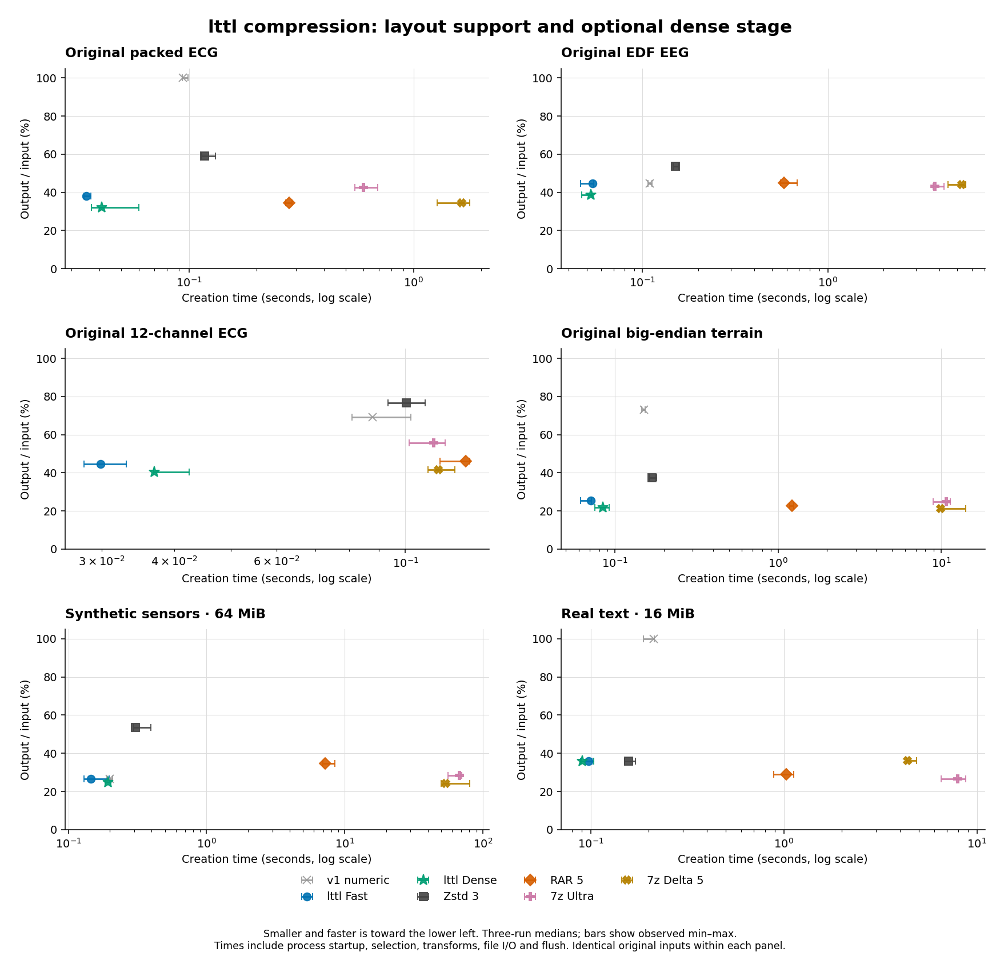

# lttl compression benchmark results

**lttl Fast** and **lttl Dense** are the new algorithm presets. This is the numeric-v2 research implementation; raw configuration IDs remain `v2-fast` and `v2-dense` for reproducibility.

**378 compression/extraction pairs passed exact SHA-256 recovery verification** across 14 inputs and 9 configurations. Three serial randomized repetitions per case. V2 archive bytes are deterministic across repetitions. Source, binary and corpus hashes were verified.

Core Ultra 9 185H; eight requested CPU workers. Actual RAR 7.20.3 x64 and 7-Zip 26.04 x64. No GPU v2 implementation is measured. [Methodology and reproduction](README.md), [raw measurements](results.json), [input manifest](corpus.json).

## Measured outcome

The dense stage substantially closes the numeric compression gap. Its CPU cost is visible below; it is not free compression. Fast remains available when packing alone is preferable.

* **Original packed ECG:** Dense produces 32.10% of input, versus 100.00% for v1 numeric. Its output is -7.2% relative to RAR method 5 and -6.6% relative to delta-filtered 7z (negative means smaller). Creation is 6.83x faster than RAR and 40.16x faster than filtered 7z at these settings.
* **Original EDF EEG:** Dense produces 38.77% of input, versus 44.59% for v1 numeric. Its output is -13.6% relative to RAR method 5 and -12.3% relative to delta-filtered 7z (negative means smaller). Creation is 11.01x faster than RAR and 100.07x faster than filtered 7z at these settings.
* **Original 12-channel ECG:** Dense produces 40.51% of input, versus 69.31% for v1 numeric. Its output is -12.1% relative to RAR method 5 and -2.9% relative to delta-filtered 7z (negative means smaller). Creation is 3.44x faster than RAR and 3.08x faster than filtered 7z at these settings.
* **Original big-endian terrain:** Dense produces 21.87% of input, versus 73.05% for v1 numeric. Its output is -3.3% relative to RAR method 5 and +3.1% relative to delta-filtered 7z (negative means smaller). Creation is 14.44x faster than RAR and 117.19x faster than filtered 7z at these settings.
* **64 MiB synthetic sensors:** Dense produces 24.92% of input, versus 26.66% for v1 numeric. Its output is -28.0% relative to RAR method 5 and +2.8% relative to delta-filtered 7z (negative means smaller). Creation is 37.44x faster than RAR and 278.55x faster than filtered 7z at these settings.

These are specified settings, not an exhaustive tuning contest. Delta-filtered 7z receives the newly detected stride outside its timer, including improved distances for original packed and 12-channel ECG. Converted ECG/terrain remain separate reference inputs, not substitutes for originals.

**The speed goal is only partly met.** On 64 MiB sensors, codec-only time changes from 38.55 ms for v1 to 45.06 ms for lttl Fast and 89.96 ms for lttl Dense. Dense output is 6.5% smaller than v1. Full-process timings also reflect different executable launch costs; they must not be used alone to claim faster numeric math. Small-input sampling overhead and slower generic decoding remain optimization targets.

## Compression ratio

Full output bytes / input bytes, percent; lower is smaller. Headers are included. Text uses ordinary Zstd fallback; noise may be stored. No lossy representation is used.

| Input | v1 numeric | v1 adaptive | lttl Fast | lttl Dense | Zstd 3 | RAR 5 | 7z 5 | 7z 9 | 7z Delta 5 |
|---|---:|---:|---:|---:|---:|---:|---:|---:|---:|
| mitbih-original-212 | 100.00% | 58.94% | 38.08% | 32.10% | 58.94% | 34.58% | 42.65% | 42.65% | 34.35% |
| mitbih-s16le | 28.56% | 28.56% | 28.56% | 24.07% | 45.16% | 26.53% | 29.51% | 29.51% | 24.07% |
| eeg-edf-original | 44.59% | 53.66% | 44.65% | 38.77% | 53.66% | 44.89% | 43.30% | 43.28% | 44.19% |
| ptb-12lead-original | 69.31% | 76.53% | 44.53% | 40.51% | 76.53% | 46.10% | 55.65% | 55.65% | 41.74% |
| terrain-hgt-be | 73.05% | 37.33% | 25.58% | 21.87% | 37.33% | 22.62% | 25.20% | 24.89% | 21.22% |
| terrain-s16le | 25.58% | 25.58% | 25.58% | 21.87% | 37.31% | 22.61% | 25.30% | 24.99% | 21.23% |
| raw-sensors-1MiB | 26.66% | 26.66% | 26.66% | 24.93% | 54.11% | 40.21% | 29.94% | 29.94% | 24.81% |
| raw-sensors-16MiB | 26.66% | 26.66% | 26.69% | 24.92% | 53.46% | 35.56% | 28.89% | 28.89% | 24.35% |
| raw-sensors-64MiB | 26.66% | 26.66% | 26.69% | 24.92% | 53.44% | 34.59% | 28.39% | 28.33% | 24.24% |
| independent-noise-16MiB | 100.00% | 100.00% | 100.00% | 100.00% | 100.00% | 100.19% | 100.01% | 100.01% | 100.01% |
| enwik8-16MiB | 100.00% | 35.75% | 35.75% | 35.75% | 35.75% | 28.91% | 26.88% | 26.72% | 36.29% |
| synthetic-u32be-12ch | 100.00% | 79.91% | 13.30% | 8.92% | 79.91% | 10.44% | 13.27% | 13.27% | 9.98% |
| synthetic-u64le-3ch | 70.32% | 18.39% | 8.05% | 4.93% | 18.39% | 4.83% | 7.58% | 7.58% | 5.28% |
| synthetic-f64be-3ch | 100.00% | 34.73% | 34.73% | 6.80% | 34.73% | 5.37% | 9.08% | 9.08% | 24.32% |

## Creation: complete process time

Milliseconds, medians of three runs. Includes process launch, file IO and common output fsync. Creation includes layout detection and transforms; extraction uses the recorded layout and inverts those transforms. No mixing with kernel-only times.

| Input | v1 numeric | v1 adaptive | lttl Fast | lttl Dense | Zstd 3 | RAR 5 | 7z 5 | 7z 9 | 7z Delta 5 |
|---|---:|---:|---:|---:|---:|---:|---:|---:|---:|
| mitbih-original-212 | 93.9 | 112.4 | 34.9 | 40.8 | 117.3 | 278.8 | 534.1 | 598.2 | 1638.6 |
| mitbih-s16le | 94.6 | 98.2 | 35.8 | 40.5 | 124.6 | 343.4 | 871.3 | 884.4 | 2212.8 |
| eeg-edf-original | 109.8 | 159.3 | 53.7 | 52.8 | 151.0 | 581.8 | 3766.0 | 3780.3 | 5287.0 |
| ptb-12lead-original | 87.8 | 96.2 | 29.9 | 36.9 | 100.3 | 127.1 | 112.3 | 111.9 | 113.9 |
| terrain-hgt-be | 151.1 | 159.8 | 71.3 | 84.4 | 168.2 | 1218.3 | 9486.8 | 10747.1 | 9886.6 |
| terrain-s16le | 135.3 | 126.2 | 69.8 | 81.7 | 167.1 | 1208.9 | 9771.1 | 8399.6 | 10003.5 |
| raw-sensors-1MiB | 86.5 | 90.4 | 32.1 | 38.0 | 95.1 | 144.6 | 133.5 | 142.3 | 192.0 |
| raw-sensors-16MiB | 121.5 | 123.1 | 59.3 | 85.9 | 173.1 | 1462.7 | 10049.8 | 8156.2 | 13322.1 |
| raw-sensors-64MiB | 198.4 | 213.3 | 145.0 | 193.8 | 306.5 | 7257.2 | 50808.9 | 67599.3 | 53987.6 |
| independent-noise-16MiB | 144.0 | 142.2 | 76.0 | 91.9 | 147.1 | 665.4 | 720.5 | 798.5 | 786.9 |
| enwik8-16MiB | 212.1 | 150.7 | 97.6 | 90.8 | 156.8 | 1029.1 | 7768.4 | 7966.7 | 4379.7 |
| synthetic-u32be-12ch | 95.6 | 101.0 | 29.7 | 32.8 | 103.2 | 183.1 | 115.3 | 120.1 | 440.4 |
| synthetic-u64le-3ch | 92.5 | 102.8 | 29.0 | 35.1 | 99.6 | 159.2 | 177.9 | 228.4 | 282.9 |
| synthetic-f64be-3ch | 92.3 | 94.8 | 45.1 | 34.4 | 100.2 | 169.6 | 155.0 | 165.5 | 162.8 |

## Extraction: complete process time

Milliseconds, medians of three runs. Includes process launch, file IO and common output fsync. Creation includes layout detection and transforms; extraction uses the recorded layout and inverts those transforms. No mixing with kernel-only times.

| Input | v1 numeric | v1 adaptive | lttl Fast | lttl Dense | Zstd 3 | RAR 5 | 7z 5 | 7z 9 | 7z Delta 5 |
|---|---:|---:|---:|---:|---:|---:|---:|---:|---:|
| mitbih-original-212 | 94.0 | 94.1 | 33.8 | 39.8 | 95.3 | 107.5 | 86.5 | 101.2 | 84.8 |
| mitbih-s16le | 96.0 | 100.4 | 38.4 | 39.7 | 111.6 | 111.2 | 117.8 | 99.2 | 75.5 |
| eeg-edf-original | 108.5 | 127.2 | 56.1 | 54.1 | 127.7 | 163.8 | 164.5 | 146.2 | 204.7 |
| ptb-12lead-original | 92.8 | 83.2 | 31.1 | 28.3 | 91.9 | 96.7 | 44.1 | 44.3 | 38.7 |
| terrain-hgt-be | 153.6 | 174.3 | 85.0 | 90.2 | 173.4 | 193.8 | 283.7 | 317.6 | 225.3 |
| terrain-s16le | 128.4 | 128.3 | 83.6 | 91.0 | 172.5 | 199.0 | 257.6 | 264.1 | 225.5 |
| raw-sensors-1MiB | 95.9 | 91.0 | 29.2 | 31.5 | 89.8 | 100.8 | 43.6 | 46.3 | 39.0 |
| raw-sensors-16MiB | 121.9 | 115.2 | 66.5 | 73.3 | 151.3 | 197.8 | 284.9 | 256.0 | 160.1 |
| raw-sensors-64MiB | 191.0 | 204.7 | 184.7 | 185.3 | 336.5 | 430.0 | 1094.3 | 1015.9 | 563.0 |
| independent-noise-16MiB | 113.8 | 120.2 | 62.7 | 68.8 | 124.2 | 152.2 | 59.8 | 59.6 | 73.6 |
| enwik8-16MiB | 259.2 | 271.7 | 251.5 | 241.2 | 268.5 | 370.4 | 340.2 | 316.4 | 371.6 |
| synthetic-u32be-12ch | 96.7 | 93.4 | 32.1 | 28.6 | 92.1 | 102.0 | 62.2 | 55.2 | 38.5 |
| synthetic-u64le-3ch | 91.8 | 95.2 | 29.1 | 31.7 | 94.4 | 100.4 | 41.1 | 40.1 | 34.5 |
| synthetic-f64be-3ch | 99.0 | 89.6 | 37.5 | 29.7 | 92.7 | 102.4 | 43.6 | 45.3 | 61.1 |

## Algorithm cost without executable/file startup

Encode-only milliseconds inside the Rust workers. Includes layout selection, transforms, compression and checksum; excludes input/output and thread-pool initialization. Fresh worker per run. These timings cannot be substituted for RAR/7z process times. They show whether density improvements cost CPU time even when process overhead masks it.

| Input | v1 numeric codec | lttl Fast codec | lttl Dense codec | Dense / v1 time | Fast selection | Dense selection |
|---|---:|---:|---:|---:|---:|---:|
| mitbih-original-212 | 6.15 | 6.14 | 10.51 | 1.71x | 1.66 | 4.54 |
| mitbih-s16le | 4.89 | 5.61 | 9.01 | 1.84x | 1.38 | 4.15 |
| eeg-edf-original | 8.48 | 10.06 | 13.90 | 1.64x | 1.54 | 3.30 |
| ptb-12lead-original | 1.98 | 3.21 | 7.78 | 3.92x | 1.42 | 3.65 |
| terrain-hgt-be | 26.48 | 18.03 | 36.70 | 1.39x | 1.81 | 3.54 |
| terrain-s16le | 16.15 | 16.71 | 29.54 | 1.83x | 1.62 | 3.58 |
| raw-sensors-1MiB | 2.07 | 3.98 | 8.09 | 3.90x | 1.81 | 3.22 |
| raw-sensors-16MiB | 12.45 | 13.75 | 30.09 | 2.42x | 1.72 | 3.91 |
| raw-sensors-64MiB | 38.55 | 45.06 | 89.96 | 2.33x | 1.41 | 4.08 |
| independent-noise-16MiB | 21.61 | 19.81 | 28.11 | 1.30x | 1.29 | 4.65 |
| enwik8-16MiB | 21.16 | 48.27 | 50.76 | 2.40x | 1.80 | 3.42 |
| synthetic-u32be-12ch | 4.77 | 3.81 | 5.52 | 1.16x | 1.54 | 2.80 |
| synthetic-u64le-3ch | 3.20 | 2.97 | 6.18 | 1.93x | 1.41 | 2.78 |
| synthetic-f64be-3ch | 4.46 | 14.10 | 6.16 | 1.38x | 1.81 | 2.92 |

### Decoder-only cost

Milliseconds inside each Rust worker, including content checksum and excluding file IO and pool startup. This separates decoder work from the different executable launch costs.

| Input | v1 numeric decode | lttl Fast decode | lttl Dense decode |
|---|---:|---:|---:|
| mitbih-original-212 | 1.10 | 8.34 | 8.27 |
| mitbih-s16le | 4.10 | 5.70 | 7.77 |
| eeg-edf-original | 6.83 | 13.77 | 17.10 |
| ptb-12lead-original | 1.75 | 2.98 | 4.33 |
| terrain-hgt-be | 17.17 | 30.17 | 37.25 |
| terrain-s16le | 16.32 | 28.29 | 35.61 |
| raw-sensors-1MiB | 1.65 | 3.30 | 4.16 |
| raw-sensors-16MiB | 10.69 | 18.76 | 24.72 |
| raw-sensors-64MiB | 36.55 | 67.01 | 85.52 |
| independent-noise-16MiB | 3.89 | 4.46 | 5.03 |
| enwik8-16MiB | 4.96 | 29.93 | 32.03 |
| synthetic-u32be-12ch | 0.57 | 2.73 | 3.18 |
| synthetic-u64le-3ch | 1.98 | 1.86 | 3.28 |
| synthetic-f64be-3ch | 0.71 | 5.70 | 3.73 |

## Detected plans

These are compression hypotheses, not guaranteed semantic types. A floating-point control may favor generic Zstd over an XOR transform. Selection examines bytes, not filenames.

| Input | Fast | Dense | 7z Delta distance (bytes) |
|---|---|---|---:|
| mitbih-original-212 | packed-212, delta, stride 2; tile pack | packed-212, delta, stride 2; Zstd packed tiles | 3 |
| mitbih-s16le | 16LE, delta, stride 2; tile pack | 16LE, delta, stride 2; Zstd packed tiles | 4 |
| eeg-edf-original | 16LE, delta, stride 1; tile pack | 16LE, delta, stride 1; Zstd planes | 2 |
| ptb-12lead-original | 16LE, delta, stride 12; tile pack | 16LE, delta, stride 12; Zstd planes | 24 |
| terrain-hgt-be | 16BE, delta, stride 1; tile pack | 16BE, delta, stride 1; Zstd planes | 2 |
| terrain-s16le | 16LE, delta, stride 1; tile pack | 16LE, delta, stride 1; Zstd planes | 2 |
| raw-sensors-1MiB | 16LE, delta, stride 16; tile pack | 16LE, delta, stride 16; Zstd planes | 32 |
| raw-sensors-16MiB | 16LE, delta, stride 16; tile pack | 16LE, delta, stride 16; Zstd planes | 32 |
| raw-sensors-64MiB | 16LE, delta, stride 16; tile pack | 16LE, delta, stride 16; Zstd planes | 32 |
| independent-noise-16MiB | 16LE, delta, stride 1; store | 16LE, delta, stride 1; store | 2 |
| enwik8-16MiB | 16LE, delta, stride 1; ordinary Zstd | 16LE, delta, stride 1; ordinary Zstd | 2 |
| synthetic-u32be-12ch | 32BE, delta, stride 12; tile pack | 32BE, delta, stride 12; Zstd packed tiles | 48 |
| synthetic-u64le-3ch | 64LE, delta, stride 3; tile pack | 64LE, delta, stride 3; Zstd planes | 24 |
| synthetic-f64be-3ch | 16LE, delta, stride 1; ordinary Zstd | 64LE, XOR, stride 3; Zstd planes | 2 |

## Chart

[Vector chart](tradeoffs.svg). Error bars are observed min/max across three runs. All chart timings use the same complete-process boundary.

## Every configuration and observed variability

### mitbih-original-212

3,900,000 input bytes. Original packed ECG records 100 and 101 concatenated in order, no sample conversion.

| Configuration | Output bytes | Create median ms | Create min–max | Extract median ms | Extract min–max |
|---|---:|---:|---:|---:|---:|
| cpu-numeric | 3,900,026 | 93.9 | 93.4–99.0 | 94.0 | 82.9–98.9 |
| adaptive | 2,298,763 | 112.4 | 112.4–127.2 | 94.1 | 93.9–122.2 |
| v2-fast | 1,485,095 | 34.9 | 34.2–36.7 | 33.8 | 33.3–39.8 |
| v2-dense | 1,251,822 | 40.8 | 36.9–60.0 | 39.8 | 36.0–41.1 |
| zstd-3 | 2,298,763 | 117.3 | 114.4–131.4 | 95.3 | 94.6–106.6 |
| rar-5 | 1,348,552 | 278.8 | 269.2–288.4 | 107.5 | 101.5–112.2 |
| 7z-5 | 1,663,520 | 534.1 | 474.6–674.6 | 86.5 | 83.4–95.2 |
| 7z-9 | 1,663,520 | 598.2 | 547.6–692.0 | 101.2 | 98.1–105.2 |
| 7z-delta-5 | 1,339,675 | 1638.6 | 1273.5–1779.8 | 84.8 | 70.6–87.9 |

### mitbih-s16le

5,200,000 input bytes. Same records unpacked losslessly from WFDB 212 to interleaved signed 16-bit little-endian samples. Exact 212 repacking verified. Conversion is outside compression timing.

| Configuration | Output bytes | Create median ms | Create min–max | Extract median ms | Extract min–max |
|---|---:|---:|---:|---:|---:|
| cpu-numeric | 1,485,120 | 94.6 | 92.0–98.3 | 96.0 | 93.5–100.1 |
| adaptive | 1,485,120 | 98.2 | 92.1–105.9 | 100.4 | 94.0–114.4 |
| v2-fast | 1,485,198 | 35.8 | 32.9–39.6 | 38.4 | 37.2–43.9 |
| v2-dense | 1,251,787 | 40.5 | 38.3–45.9 | 39.7 | 37.8–43.9 |
| zstd-3 | 2,348,117 | 124.6 | 112.5–129.9 | 111.6 | 107.7–116.5 |
| rar-5 | 1,379,625 | 343.4 | 322.4–348.4 | 111.2 | 108.2–116.6 |
| 7z-5 | 1,534,511 | 871.3 | 866.6–1088.1 | 117.8 | 105.8–124.1 |
| 7z-9 | 1,534,511 | 884.4 | 828.3–946.7 | 99.2 | 84.8–102.8 |
| 7z-delta-5 | 1,251,442 | 2212.8 | 1829.6–2324.4 | 75.5 | 74.2–82.2 |

### eeg-edf-original

10,305,024 input bytes. Four complete original EDF+ files S001R03 through S004R03 concatenated in order, including headers and annotation channels. No conversion, scaling, duplication or quantization.

| Configuration | Output bytes | Create median ms | Create min–max | Extract median ms | Extract min–max |
|---|---:|---:|---:|---:|---:|
| cpu-numeric | 4,594,850 | 109.8 | 107.3–112.9 | 108.5 | 106.8–111.0 |
| adaptive | 5,529,877 | 159.3 | 144.0–174.9 | 127.2 | 125.8–128.1 |
| v2-fast | 4,600,727 | 53.7 | 46.2–54.5 | 56.1 | 53.7–57.0 |
| v2-dense | 3,995,180 | 52.8 | 46.9–53.4 | 54.1 | 49.1–57.3 |
| zstd-3 | 5,529,877 | 151.0 | 145.9–155.7 | 127.7 | 116.4–127.9 |
| rar-5 | 4,626,120 | 581.8 | 557.4–685.0 | 163.8 | 149.7–164.5 |
| 7z-5 | 4,461,770 | 3766.0 | 3726.9–5272.5 | 164.5 | 145.7–172.4 |
| 7z-9 | 4,460,439 | 3780.3 | 3714.1–4225.3 | 146.2 | 142.9–156.7 |
| 7z-delta-5 | 4,553,724 | 5287.0 | 4464.7–5550.0 | 204.7 | 171.9–224.9 |

### ptb-12lead-original

921,600 input bytes. Original 12-channel signed 16-bit little-endian ECG .dat file; 12-channel stride is deliberately outside the original codec candidate set. No conversion.

| Configuration | Output bytes | Create median ms | Create min–max | Extract median ms | Extract min–max |
|---|---:|---:|---:|---:|---:|
| cpu-numeric | 638,790 | 87.8 | 80.9–102.1 | 92.8 | 91.3–94.9 |
| adaptive | 705,310 | 96.2 | 89.2–101.3 | 83.2 | 82.5–85.3 |
| v2-fast | 410,398 | 29.9 | 28.0–33.1 | 31.1 | 26.3–34.6 |
| v2-dense | 373,342 | 36.9 | 36.9–42.4 | 28.3 | 24.5–35.9 |
| zstd-3 | 705,310 | 100.3 | 93.4–108.2 | 91.9 | 88.1–92.1 |
| rar-5 | 424,817 | 127.1 | 114.8–129.0 | 96.7 | 94.4–104.9 |
| 7z-5 | 512,894 | 112.3 | 103.4–115.6 | 44.1 | 42.6–49.1 |
| 7z-9 | 512,894 | 111.9 | 101.5–117.1 | 44.3 | 43.0–47.4 |
| 7z-delta-5 | 384,683 | 113.9 | 109.4–121.7 | 38.7 | 36.5–39.2 |

### terrain-hgt-be

25,934,402 input bytes. Complete N37W122 elevation tile, gzip transport removed. Original big-endian signed 16-bit HGT samples.

| Configuration | Output bytes | Create median ms | Create min–max | Extract median ms | Extract min–max |
|---|---:|---:|---:|---:|---:|
| cpu-numeric | 18,945,820 | 151.1 | 146.1–153.2 | 153.6 | 141.1–166.1 |
| adaptive | 9,682,603 | 159.8 | 155.6–170.5 | 174.3 | 165.8–175.3 |
| v2-fast | 6,633,909 | 71.3 | 61.3–71.7 | 85.0 | 80.5–85.3 |
| v2-dense | 5,672,840 | 84.4 | 75.5–92.0 | 90.2 | 86.8–101.0 |
| zstd-3 | 9,682,603 | 168.2 | 163.4–179.7 | 173.4 | 167.5–174.1 |
| rar-5 | 5,865,183 | 1218.3 | 1177.7–1242.9 | 193.8 | 184.0–215.6 |
| 7z-5 | 6,534,747 | 9486.8 | 7626.5–10278.6 | 283.7 | 268.7–343.9 |
| 7z-9 | 6,454,649 | 10747.1 | 8940.2–11421.6 | 317.6 | 300.8–332.8 |
| 7z-delta-5 | 5,503,160 | 9886.6 | 9583.0–14160.1 | 225.3 | 217.2–238.2 |

### terrain-s16le

25,934,402 input bytes. Same complete elevation tile with reversible byte swap to little endian, no quantization. Byte-swap conversion is outside compression timing.

| Configuration | Output bytes | Create median ms | Create min–max | Extract median ms | Extract min–max |
|---|---:|---:|---:|---:|---:|
| cpu-numeric | 6,634,304 | 135.3 | 130.7–142.2 | 128.4 | 125.6–138.3 |
| adaptive | 6,634,304 | 126.2 | 120.1–127.5 | 128.3 | 125.6–150.0 |
| v2-fast | 6,633,909 | 69.8 | 61.1–73.8 | 83.6 | 81.3–86.8 |
| v2-dense | 5,672,840 | 81.7 | 80.5–82.3 | 91.0 | 82.6–94.9 |
| zstd-3 | 9,674,854 | 167.1 | 166.4–189.3 | 172.5 | 155.0–174.4 |
| rar-5 | 5,864,026 | 1208.9 | 1191.0–1218.0 | 199.0 | 196.2–200.5 |
| 7z-5 | 6,561,058 | 9771.1 | 8236.9–10750.7 | 257.6 | 243.8–275.6 |
| 7z-9 | 6,480,395 | 8399.6 | 8310.0–9044.2 | 264.1 | 262.8–265.6 |
| 7z-delta-5 | 5,505,391 | 10003.5 | 9657.7–14042.3 | 225.5 | 224.7–226.3 |

### raw-sensors-1MiB

1,048,576 input bytes. Existing corpus control: first 1 MiB. Sensor/noise controls are synthetic; enwik8 is real text.

| Configuration | Output bytes | Create median ms | Create min–max | Extract median ms | Extract min–max |
|---|---:|---:|---:|---:|---:|
| cpu-numeric | 279,574 | 86.5 | 83.5–97.6 | 95.9 | 83.8–96.4 |
| adaptive | 279,574 | 90.4 | 85.6–91.9 | 91.0 | 89.0–95.9 |
| v2-fast | 279,595 | 32.1 | 31.6–37.0 | 29.2 | 26.2–40.7 |
| v2-dense | 261,427 | 38.0 | 33.3–45.8 | 31.5 | 30.5–35.5 |
| zstd-3 | 567,391 | 95.1 | 93.9–98.4 | 89.8 | 85.7–90.9 |
| rar-5 | 421,581 | 144.6 | 137.5–193.1 | 100.8 | 95.4–117.4 |
| 7z-5 | 313,957 | 133.5 | 132.7–161.4 | 43.6 | 40.5–46.7 |
| 7z-9 | 313,957 | 142.3 | 141.8–150.9 | 46.3 | 45.1–50.5 |
| 7z-delta-5 | 260,117 | 192.0 | 174.2–211.3 | 39.0 | 30.7–47.9 |

### raw-sensors-16MiB

16,777,216 input bytes. Existing corpus control: first 16 MiB. Sensor/noise controls are synthetic; enwik8 is real text.

| Configuration | Output bytes | Create median ms | Create min–max | Extract median ms | Extract min–max |
|---|---:|---:|---:|---:|---:|
| cpu-numeric | 4,472,942 | 121.5 | 111.4–128.3 | 121.9 | 111.4–127.7 |
| adaptive | 4,472,942 | 123.1 | 113.6–129.9 | 115.2 | 112.9–118.4 |
| v2-fast | 4,477,442 | 59.3 | 58.5–60.5 | 66.5 | 64.6–67.0 |
| v2-dense | 4,181,435 | 85.9 | 81.8–86.1 | 73.3 | 72.0–91.4 |
| zstd-3 | 8,969,590 | 173.1 | 172.1–245.0 | 151.3 | 140.6–156.9 |
| rar-5 | 5,965,736 | 1462.7 | 1281.5–1535.8 | 197.8 | 168.3–200.7 |
| 7z-5 | 4,846,365 | 10049.8 | 9698.5–10808.3 | 284.9 | 253.9–321.6 |
| 7z-9 | 4,846,365 | 8156.2 | 8065.8–10395.4 | 256.0 | 255.9–267.6 |
| 7z-delta-5 | 4,084,732 | 13322.1 | 13032.5–13600.0 | 160.1 | 152.9–196.6 |

### raw-sensors-64MiB

67,108,864 input bytes. Existing corpus control: first 64 MiB. Sensor/noise controls are synthetic; enwik8 is real text.

| Configuration | Output bytes | Create median ms | Create min–max | Extract median ms | Extract min–max |
|---|---:|---:|---:|---:|---:|
| cpu-numeric | 17,891,694 | 198.4 | 189.7–208.7 | 191.0 | 183.3–193.3 |
| adaptive | 17,891,694 | 213.3 | 192.2–214.9 | 204.7 | 193.3–206.6 |
| v2-fast | 17,909,950 | 145.0 | 130.5–196.9 | 184.7 | 157.7–207.5 |
| v2-dense | 16,725,440 | 193.8 | 185.6–204.1 | 185.3 | 163.1–215.7 |
| zstd-3 | 35,861,700 | 306.5 | 297.7–397.2 | 336.5 | 326.4–337.7 |
| rar-5 | 23,213,950 | 7257.2 | 6954.8–8489.5 | 430.0 | 421.3–505.1 |
| 7z-5 | 19,053,724 | 50808.9 | 49511.0–57783.8 | 1094.3 | 1061.0–1127.1 |
| 7z-9 | 19,015,273 | 67599.3 | 56103.2–70436.6 | 1015.9 | 974.5–1146.5 |
| 7z-delta-5 | 16,266,835 | 53987.6 | 50052.1–80377.3 | 563.0 | 547.5–644.7 |

### independent-noise-16MiB

16,777,216 input bytes. Existing corpus control: first 16 MiB. Sensor/noise controls are synthetic; enwik8 is real text.

| Configuration | Output bytes | Create median ms | Create min–max | Extract median ms | Extract min–max |
|---|---:|---:|---:|---:|---:|
| cpu-numeric | 16,777,242 | 144.0 | 144.0–144.5 | 113.8 | 112.3–125.9 |
| adaptive | 16,777,242 | 142.2 | 135.5–147.6 | 120.2 | 120.1–145.0 |
| v2-fast | 16,777,245 | 76.0 | 70.0–78.0 | 62.7 | 56.2–75.4 |
| v2-dense | 16,777,245 | 91.9 | 75.3–92.2 | 68.8 | 58.7–71.5 |
| zstd-3 | 16,777,242 | 147.1 | 133.9–158.8 | 124.2 | 114.3–130.2 |
| rar-5 | 16,808,685 | 665.4 | 631.6–685.9 | 152.2 | 149.5–158.7 |
| 7z-5 | 16,778,420 | 720.5 | 704.3–817.9 | 59.8 | 57.1–60.6 |
| 7z-9 | 16,778,420 | 798.5 | 751.6–865.7 | 59.6 | 55.7–62.3 |
| 7z-delta-5 | 16,778,436 | 786.9 | 671.0–787.4 | 73.6 | 72.2–82.9 |

### enwik8-16MiB

16,777,216 input bytes. Existing corpus control: first 16 MiB. Sensor/noise controls are synthetic; enwik8 is real text.

| Configuration | Output bytes | Create median ms | Create min–max | Extract median ms | Extract min–max |
|---|---:|---:|---:|---:|---:|
| cpu-numeric | 16,777,242 | 212.1 | 188.3–212.9 | 259.2 | 236.8–265.5 |
| adaptive | 5,998,117 | 150.7 | 146.5–168.3 | 271.7 | 217.4–300.7 |
| v2-fast | 5,998,120 | 97.6 | 88.4–102.0 | 251.5 | 248.4–284.1 |
| v2-dense | 5,998,120 | 90.8 | 89.6–103.5 | 241.2 | 205.0–249.4 |
| zstd-3 | 5,998,117 | 156.8 | 150.0–170.8 | 268.5 | 253.3–278.2 |
| rar-5 | 4,850,108 | 1029.1 | 887.2–1129.3 | 370.4 | 314.0–376.3 |
| 7z-5 | 4,509,537 | 7768.4 | 6669.5–8222.8 | 340.2 | 297.0–377.5 |
| 7z-9 | 4,483,036 | 7966.7 | 6548.6–8751.0 | 316.4 | 285.7–399.4 |
| 7z-delta-5 | 6,087,673 | 4379.7 | 4328.8–4885.5 | 371.6 | 329.3–378.1 |

### synthetic-u32be-12ch

2,097,152 input bytes. Synthetic big-endian 32-bit, 12 interleaved channels, wrapping counters plus deterministic small noise; 2 MiB.

| Configuration | Output bytes | Create median ms | Create min–max | Extract median ms | Extract min–max |
|---|---:|---:|---:|---:|---:|
| cpu-numeric | 2,097,178 | 95.6 | 91.0–96.1 | 96.7 | 95.0–97.3 |
| adaptive | 1,675,907 | 101.0 | 97.3–112.3 | 93.4 | 82.9–100.2 |
| v2-fast | 278,824 | 29.7 | 29.5–39.5 | 32.1 | 29.3–34.7 |
| v2-dense | 187,120 | 32.8 | 32.3–35.1 | 28.6 | 28.5–32.0 |
| zstd-3 | 1,675,907 | 103.2 | 94.2–108.1 | 92.1 | 91.4–98.8 |
| rar-5 | 219,029 | 183.1 | 166.6–197.5 | 102.0 | 83.9–103.6 |
| 7z-5 | 278,211 | 115.3 | 103.5–128.3 | 62.2 | 47.5–63.5 |
| 7z-9 | 278,211 | 120.1 | 115.5–133.1 | 55.2 | 52.6–58.7 |
| 7z-delta-5 | 209,297 | 440.4 | 426.5–559.8 | 38.5 | 32.6–49.3 |

### synthetic-u64le-3ch

2,097,152 input bytes. Synthetic little-endian 64-bit, three interleaved counters above 2^53, with wrapping and small deterministic noise; 2 MiB.

| Configuration | Output bytes | Create median ms | Create min–max | Extract median ms | Extract min–max |
|---|---:|---:|---:|---:|---:|
| cpu-numeric | 1,474,630 | 92.5 | 87.8–94.5 | 91.8 | 83.7–92.5 |
| adaptive | 385,770 | 102.8 | 96.1–105.5 | 95.2 | 94.5–95.6 |
| v2-fast | 168,869 | 29.0 | 27.4–29.9 | 29.1 | 24.8–30.9 |
| v2-dense | 103,339 | 35.1 | 31.7–41.7 | 31.7 | 28.5–32.9 |
| zstd-3 | 385,770 | 99.6 | 93.5–100.6 | 94.4 | 89.9–95.2 |
| rar-5 | 101,245 | 159.2 | 156.8–159.5 | 100.4 | 96.6–103.3 |
| 7z-5 | 158,890 | 177.9 | 161.0–204.2 | 41.1 | 40.4–48.0 |
| 7z-9 | 158,890 | 228.4 | 207.4–314.2 | 40.1 | 38.5–56.3 |
| 7z-delta-5 | 110,652 | 282.9 | 280.8–327.3 | 34.5 | 32.9–36.8 |

### synthetic-f64be-3ch

2,097,152 input bytes. Synthetic big-endian binary64, three channels, exactly represented increments plus sparse NaN payloads, signed zero and infinities; 2 MiB. No floating point arithmetic in codec.

| Configuration | Output bytes | Create median ms | Create min–max | Extract median ms | Extract min–max |
|---|---:|---:|---:|---:|---:|
| cpu-numeric | 2,097,178 | 92.3 | 88.3–107.8 | 99.0 | 95.8–100.0 |
| adaptive | 728,250 | 94.8 | 91.3–101.0 | 89.6 | 87.4–95.2 |
| v2-fast | 728,253 | 45.1 | 39.2–49.2 | 37.5 | 32.3–40.5 |
| v2-dense | 142,620 | 34.4 | 29.9–36.4 | 29.7 | 26.2–33.8 |
| zstd-3 | 728,250 | 100.2 | 99.0–109.1 | 92.7 | 92.6–93.0 |
| rar-5 | 112,540 | 169.6 | 151.7–171.5 | 102.4 | 99.1–105.0 |
| 7z-5 | 190,526 | 155.0 | 141.5–184.5 | 43.6 | 38.1–57.0 |
| 7z-9 | 190,526 | 165.5 | 141.4–169.4 | 45.3 | 38.2–47.5 |
| 7z-delta-5 | 510,007 | 162.8 | 128.0–164.0 | 61.1 | 47.3–61.2 |

## Limits and next decision

* Development and selection adjustments used this corpus. These are exploratory in-corpus results, not holdout validation.
* Fast/Dense are CPU research presets. V1 GPU code and production Auto are unchanged. A GPU port would need separate ratio/correctness/transfer measurements.
* Generic text compression still trails the dense archive presets; the new numeric stage is not a universal codec replacement.
* Native layout support removes the need for external endian swapping or packed-212 expansion on the tested originals. It does not parse arbitrary scientific containers, mixed schemas, arbitrary channel counts or unaligned data prefixes.
* Power, thermal state, OS caches, CPU placement and background activity are uncontrolled. Three repetitions do not establish statistical significance.
* RAR/7z contain a filename and metadata; prototype frames contain payload only. Different dictionaries and memory usage are not normalized.
* Keep the dense stage optional: internal codec timings and small-input costs matter, even when it remains far faster than RAR/7z.
